# 🗺️ Cartographie du Monorepo

Ce document cartographie la structure complète du monorepo **Rose Griffon**. Il est maintenu automatiquement et sert de source de vérité pour les développeurs et les assistants IA (Gemini, Claude) afin de comprendre les responsabilités et connexions de chaque module.

## 🚀 Applications (`apps/`)

Applications autonomes prêtes à être déployées :

### 📁 [@rosegriffon/azalee-web](file:///apps/azalee)
* **Chemin :** `apps/azalee`
* **Description :** Aucune description fournie.
* **Version :** `0.1.0`
* **Points d'entrée clés :**
  - [`app/page.tsx`](file:///apps/azalee/app/page.tsx)

* **Scripts disponibles :**
  - `bun run dev` : `bun --smol --bun node_modules/next/dist/bin/next dev --turbopack`
  - `bun run build` : `bash ../../scripts/next-build.sh`
  - `bun run start` : `bun node_modules/next/dist/bin/next start`
  - `bun run lint` : `oxlint -A style -A pedantic -A restriction -A react/react-in-jsx-scope -A unicorn/consistent-function-scoping -A promise/no-multiple-resolved -A react-perf . && eslint .`
  - `bun run lint:fix` : `oxlint -A style -A pedantic -A restriction -A react/react-in-jsx-scope -A unicorn/consistent-function-scoping -A promise/no-multiple-resolved -A react-perf --fix . && eslint --fix .`
  - `bun run format` : `oxfmt .`
  - `bun run format:check` : `oxfmt --check .`
  - `bun run type-check` : `tsc --noEmit`
  - `bun run test` : `bun test src tests`
  - `bun run test:run` : `vitest run`
  - `bun run create-draft` : `bun scripts/create-draft.ts`
  - `bun run backup:supabase` : `bun scripts/ops/backup-supabase-to-sqlite.ts`
  - `bun run sync:supabase` : `bun scripts/ops/sync-supabase-to-sqlite.ts`
  - `bun run sync:full` : `bun scripts/ops/sync-supabase-to-sqlite.ts --full --deletes`

* **Dépendances internes & externes :**
  - **Dependencies :** `@better-auth/agent-auth`, `@dnd-kit/core`, `@dnd-kit/sortable`, `@dnd-kit/utilities`, `@envelop/graphql-jit`, `@graphql-yoga/plugin-response-cache`, `@lexical/code`, `@lexical/file`, `@lexical/html`, `@lexical/link`, `@lexical/list`, `@lexical/markdown`, `@lexical/react`, `@lexical/rich-text`, `@lexical/table`, `@lexical/utils`, `@markdoc/markdoc`, `@radix-ui/react-accordion`, `@radix-ui/react-alert-dialog`, `@radix-ui/react-avatar`, `@radix-ui/react-checkbox`, `@radix-ui/react-collapsible`, `@radix-ui/react-dialog`, `@radix-ui/react-dropdown-menu`, `@radix-ui/react-label`, `@radix-ui/react-popover`, `@radix-ui/react-progress`, `@radix-ui/react-radio-group`, `@radix-ui/react-select`, `@radix-ui/react-separator`, `@radix-ui/react-slider`, `@radix-ui/react-slot`, `@radix-ui/react-switch`, `@radix-ui/react-tabs`, `@radix-ui/react-toggle`, `@radix-ui/react-toggle-group`, `@radix-ui/react-tooltip`, `@react-three/drei`, `@react-three/fiber`, `@react-three/postprocessing`, `@rosegriffon/assets`, `@rosegriffon/azalee`, `@rosegriffon/auth`, `@rosegriffon/better-auth-steam`, `@rosegriffon/db`, `@rosegriffon/inagle`, `@rosegriffon/inagle-cross`, `@rosegriffon/menu-render`, `@rosegriffon/menu-render-webgpu`, `@rosegriffon/types`, `@rosegriffon/ui`, `@sentry/nextjs`, `@supabase/supabase-js`, `@theatre/core`, `@theatre/r3f`, `@types/nodemailer`, `bcryptjs`, `better-auth`, `cheerio`, `class-variance-authority`, `clsx`, `cmdk`, `csv-parse`, `date-fns`, `drizzle-orm`, `embla-carousel-react`, `googleapis`, `graphql`, `graphql-yoga`, `html-to-image`, `input-otp`, `jsonwebtoken`, `kysely`, `lexical`, `lucide-react`, `motion`, `mp4-muxer`, `next`, `next-themes`, `node-ipinfo`, `nodemailer`, `pg`, `radix-ui`, `react`, `react-arborist`, `react-day-picker`, `react-dom`, `react-hook-form`, `react-image-crop`, `react-konva`, `react-resizable-panels`, `recharts`, `sharp`, `sonner`, `tailwind-merge`, `three`, `use-image`, `vaul`, `wanakana`, `web-push`, `zod`
  - **DevDependencies :** `@next/bundle-analyzer`, `@playwright/test`, `@rosegriffon/config`, `@tailwindcss/postcss`, `@tailwindcss/typography`, `@testing-library/jest-dom`, `@theatre/studio`, `@types/bun`, `@types/jsonwebtoken`, `@types/node`, `@types/pg`, `@types/react`, `@types/react-dom`, `@types/three`, `@types/web-push`, `@vitejs/plugin-react`, `@webgpu/types`, `babel-plugin-react-compiler`, `drizzle-kit`, `jsdom`, `oxlint`, `tailwindcss`, `tailwindcss-animate`, `turbo`, `typescript`, `vitest`

---

### 📁 [cdn-variants](file:///apps/cdn-variants)
* **Chemin :** `apps/cdn-variants`
* **Description :** Aucune description fournie.
* **Version :** `0.1.0`

* **Scripts disponibles :**
  - `bun run start` : `bun server.ts`
  - `bun run dev` : `bun --watch server.ts`

* **Dépendances internes & externes :**
  - **Dependencies :** Aucune
  - **DevDependencies :** Aucune

---

### 📁 [cdn](file:///apps/cdn)
* **Chemin :** `apps/cdn`
* **Description :** Aucune description fournie.
* **Version :** `0.1.0`

* **Scripts disponibles :**
  - `bun run start` : `bun server.ts`
  - `bun run dev` : `bun --watch server.ts`

* **Dépendances internes & externes :**
  - **Dependencies :** Aucune
  - **DevDependencies :** Aucune

---

### 📁 [rag-api](file:///apps/rag-api)
* **Chemin :** `apps/rag-api`
* **Description :** Aucune description fournie.
* **Version :** `0.1.0`

* **Scripts disponibles :**
  - `bun run start` : `bun server.ts`
  - `bun run dev` : `bun --watch server.ts`

* **Dépendances internes & externes :**
  - **Dependencies :** `@rosegriffon/db`
  - **DevDependencies :** Aucune

---

### 📁 [@rosegriffon/bot](file:///apps/bot)
* **Chemin :** `apps/bot`
* **Description :** Bot Discord Rose Griffon — slash commands public + admin, sync members, canvas cards
* **Version :** `0.1.0`
* **Points d'entrée clés :**
  - [`src/index.ts`](file:///apps/bot/src/index.ts)

* **Scripts disponibles :**
  - `bun run dev` : `bun --watch src/index.ts`
  - `bun run start` : `bun src/index.ts`
  - `bun run build` : `bun build src/index.ts --target=bun --packages=external --outdir=dist`
  - `bun run type-check` : `tsc --noEmit`
  - `bun run lint` : `oxlint src`
  - `bun run lint:fix` : `oxlint --fix src`
  - `bun run test` : `vitest run --passWithNoTests`
  - `bun run smoke:admin` : `bun src/scripts/smoke-admin.ts`
  - `bun run smoke:canvas` : `bun src/scripts/smoke-canvas.ts`

* **Dépendances internes & externes :**
  - **Dependencies :** `@aphrody-code/canvas`, `@rosegriffon/db`, `@rosegriffon/types`, `@rpbey/discordx`, `@supabase/supabase-js`, `discord.js`, `reflect-metadata`, `zod`
  - **DevDependencies :** `@rosegriffon/config`, `@types/bun`, `oxlint`, `typescript`, `vitest`

---

### 📁 [@rosegriffon/website](file:///apps/website)
* **Chemin :** `apps/website`
* **Description :** Aucune description fournie.
* **Version :** `1.4.0`

* **Scripts disponibles :**
  - `bun run dev` : `bun run --bun next dev`
  - `bun run test` : `bun test src`
  - `bun run test:ui` : `vitest --ui`
  - `bun run test:run` : `vitest run`
  - `bun run build` : `bash ../../scripts/next-build.sh`
  - `bun run start` : `bun run --bun next start`
  - `bun run lint` : `oxlint -A style -A pedantic -A restriction -A react/react-in-jsx-scope -A unicorn/consistent-function-scoping -A promise/no-multiple-resolved -A react-perf . && eslint .`
  - `bun run lint:fix` : `oxlint -A style -A pedantic -A restriction -A react/react-in-jsx-scope -A unicorn/consistent-function-scoping -A promise/no-multiple-resolved -A react-perf --fix . && eslint --fix .`
  - `bun run format` : `oxfmt .`
  - `bun run format:check` : `oxfmt --check .`
  - `bun run analyze` : `ANALYZE=true next build`
  - `bun run type-check` : `tsc --noEmit`
  - `bun run clean` : `rm -rf .next .turbo dist`
  - `bun run pre-deploy` : `bun scripts/pre-deploy-check.js`
  - `bun run submit-sitemap` : `bun scripts/submit-sitemap.js`
  - `bun run supabase:types` : `supabase gen types typescript --project-id isbkaeltubqittywibeh > src/types/supabase.ts`

* **Dépendances internes & externes :**
  - **Dependencies :** `@googlemaps/js-api-loader`, `@hookform/resolvers`, `@origin-space/image-cropper`, `@radix-ui/react-accordion`, `@radix-ui/react-alert-dialog`, `@radix-ui/react-aspect-ratio`, `@radix-ui/react-avatar`, `@radix-ui/react-checkbox`, `@radix-ui/react-collapsible`, `@radix-ui/react-context-menu`, `@radix-ui/react-dialog`, `@radix-ui/react-dropdown-menu`, `@radix-ui/react-hover-card`, `@radix-ui/react-label`, `@radix-ui/react-menubar`, `@radix-ui/react-navigation-menu`, `@radix-ui/react-popover`, `@radix-ui/react-progress`, `@radix-ui/react-radio-group`, `@radix-ui/react-scroll-area`, `@radix-ui/react-select`, `@radix-ui/react-separator`, `@radix-ui/react-slider`, `@radix-ui/react-slot`, `@radix-ui/react-switch`, `@radix-ui/react-tabs`, `@radix-ui/react-toggle`, `@radix-ui/react-toggle-group`, `@radix-ui/react-tooltip`, `@rosegriffon/assets`, `@rosegriffon/auth`, `@rosegriffon/db`, `@rosegriffon/patreon-bun`, `@rosegriffon/types`, `@rosegriffon/ui`, `@sentry/nextjs`, `@stripe/stripe-js`, `@supabase/ssr`, `@supabase/supabase-js`, `@tanstack/query-sync-storage-persister`, `@tanstack/react-query`, `@tanstack/react-query-persist-client`, `@tanstack/react-table`, `@tiptap/core`, `@tiptap/extension-placeholder`, `@tiptap/starter-kit`, `@types/nodemailer`, `@types/pg`, `@types/pica`, `better-auth`, `browser-image-compression`, `class-variance-authority`, `clsx`, `cmdk`, `date-fns`, `discord-api-types`, `discord.js`, `embla-carousel-react`, `googleapis`, `input-otp`, `kysely`, `lucide-react`, `motion`, `next`, `nodemailer`, `pg`, `pica`, `react`, `react-day-picker`, `react-dom`, `react-dropzone`, `react-easy-crop`, `react-hook-form`, `react-icons`, `react-quill-new`, `react-resizable-panels`, `react-tweet`, `react-twitch-embed`, `recharts`, `schema-dts`, `sonner`, `stripe`, `swr`, `tailwind-merge`, `tw-animate-css`, `vaul`, `zod`, `zustand`
  - **DevDependencies :** `@next/bundle-analyzer`, `@rosegriffon/config`, `@tailwindcss/postcss`, `@testing-library/jest-dom`, `@testing-library/react`, `@types/google.maps`, `@types/node`, `@types/react`, `@types/react-dom`, `@vitejs/plugin-react`, `babel-plugin-react-compiler`, `jsdom`, `oxlint`, `shadcn`, `sharp`, `tailwindcss`, `typescript`, `vitest`

---

### 📁 [realtime](file:///apps/realtime)
* **Chemin :** `apps/realtime`
* **Description :** Aucune description fournie.
* **Version :** `0.1.0`

* **Scripts disponibles :**
  - `bun run start` : `bun server.ts`
  - `bun run dev` : `bun --watch server.ts`

* **Dépendances internes & externes :**
  - **Dependencies :** `pg`
  - **DevDependencies :** Aucune

---

### 📁 [storage](file:///apps/storage)
* **Chemin :** `apps/storage`
* **Description :** Aucune description fournie.
* **Version :** `0.1.0`

* **Scripts disponibles :**
  - `bun run start` : `bun server.ts`
  - `bun run dev` : `bun --watch server.ts`

* **Dépendances internes & externes :**
  - **Dependencies :** Aucune
  - **DevDependencies :** Aucune

---

## 📦 Packages (`packages/`)

Packages partagés consommés par les applications :

### 📁 [@rosegriffon/iecode-config](file:///packages/iecode-config)
* **Chemin :** `packages/iecode-config`
* **Description :** Configs partagées iecode : presets tsconfig + oxlint (même pattern que @rosegriffon/config).
* **Version :** `0.1.0`

* **Scripts disponibles :**
  - Aucun script disponible.

* **Dépendances internes & externes :**
  - **Dependencies :** Aucune
  - **DevDependencies :** Aucune

---

### 📁 [@rosegriffon/azalee](file:///packages/azalee)
* **Chemin :** `packages/azalee`
* **Description :** Bibliothèque Bun du wiki Azalée (Inazuma Eleven: Victory Road) — accès données via miroir SQLite, index CPK, index de texte de jeu, résolution d'URLs CDN, recherche floue et CLI.
* **Version :** `1.0.0`
* **Points d'entrée clés :**
  - [`src/index.ts`](file:///packages/azalee/src/index.ts)

* **Scripts disponibles :**
  - `bun run build` : `bun run tsc -p tsconfig.build.json && bun scripts/copy-data.ts`
  - `bun run cli` : `bun src/cli.ts`
  - `bun run compile` : `bun scripts/build-standalone.ts`
  - `bun run serve` : `bun src/cli.ts serve`
  - `bun run sync:entries` : `bun scripts/sync-inagle-entries.ts`
  - `bun run test` : `bun test`
  - `bun run lint` : `bunx oxlint -c ../../.oxlintrc.json -A style -A pedantic -A restriction src`
  - `bun run lint:fix` : `bunx oxlint -c ../../.oxlintrc.json -A style -A pedantic -A restriction --fix src`
  - `bun run type-check` : `tsc --noEmit`
  - `bun run clean` : `rm -rf dist *.tsbuildinfo`
  - `bun run prepublishOnly` : `bun run build`

* **Dépendances internes & externes :**
  - **Dependencies :** `@rosegriffon/db`, `@rosegriffon/inagle`, `@supabase/supabase-js`, `commander`, `drizzle-orm`, `wanakana`
  - **DevDependencies :** `@rosegriffon/config`, `@types/bun`, `@types/node`, `oxlint`, `typescript`

---

### 📁 [@rosegriffon/auth](file:///packages/auth)
* **Chemin :** `packages/auth`
* **Description :** Shared authentication logic and guards for Rose Griffon apps
* **Version :** `0.1.0`
* **Points d'entrée clés :**
  - [`src/index.ts`](file:///packages/auth/src/index.ts)

* **Scripts disponibles :**
  - `bun run type-check` : `tsc --noEmit`
  - `bun run test` : `vitest run`

* **Dépendances internes & externes :**
  - **Dependencies :** `@rosegriffon/db`, `@rosegriffon/types`, `@supabase/supabase-js`, `better-auth`, `zod`
  - **DevDependencies :** `@types/bun`, `next`, `react`, `typescript`, `vitest`

---

### 📁 [@rosegriffon/config](file:///packages/config)
* **Chemin :** `packages/config`
* **Description :** Configs partagées : tsconfig, eslint, oxlint, tailwind preset
* **Version :** `0.1.0`

* **Scripts disponibles :**
  - Aucun script disponible.

* **Dépendances internes & externes :**
  - **Dependencies :** Aucune
  - **DevDependencies :** Aucune

---

### 📁 [@rosegriffon/cron](file:///packages/cron)
* **Chemin :** `packages/cron`
* **Description :** Daemon de tâches planifiées (cron) pour la maintenance DB, CDN et API
* **Version :** `0.1.0`
* **Points d'entrée clés :**
  - [`src/index.ts`](file:///packages/cron/src/index.ts)
  - [`src/tasks/ie-crawl/index.ts`](file:///packages/cron/src/tasks/ie-crawl/index.ts)

* **Scripts disponibles :**
  - `bun run start` : `bun src/index.ts`
  - `bun run build` : `bun build src/index.ts --compile --minify --sourcemap --bytecode --format esm --external @aphrody-code/bxc --external @aphrody-code/bxc/google --external @aphrody-code/bxc/internal/html-utils --outfile dist/rg-cron`
  - `bun run type-check` : `tsc -p tsconfig.typecheck.json --noEmit`
  - `bun run lint` : `bunx oxlint -c ../../.oxlintrc.json src`

* **Dépendances internes & externes :**
  - **Dependencies :** `@aphrody-code/bxc`, `@aphrody-code/x`, `@aphrody-code/zukan`, `@asteasolutions/zod-to-openapi`, `@rosegriffon/auth`, `@rosegriffon/db`, `@rosegriffon/inagle`, `@rosegriffon/types`, `cheerio`, `discord.js`, `zod`
  - **DevDependencies :** `@types/bun`, `typescript`

---

### 📁 [@rosegriffon/types](file:///packages/types)
* **Chemin :** `packages/types`
* **Description :** Types métier partagés (roles, user, discord) — source unique de vérité bot/azalee/website
* **Version :** `0.2.0`
* **Points d'entrée clés :**
  - [`src/index.ts`](file:///packages/types/src/index.ts)

* **Scripts disponibles :**
  - Aucun script disponible.

* **Dépendances internes & externes :**
  - **Dependencies :** `zod`
  - **DevDependencies :** `@rosegriffon/config`, `typescript`

---

### 📁 [@rosegriffon/inagle-cross](file:///packages/inagle-cross)
* **Chemin :** `packages/inagle-cross`
* **Description :** API de données et de rétro-conception pour Inazuma Eleven Cross — types, schémas, et analyseurs d'assets
* **Version :** `0.1.0`
* **Points d'entrée clés :**
  - [`src/index.ts`](file:///packages/inagle-cross/src/index.ts)

* **Scripts disponibles :**
  - `bun run type-check` : `tsc --noEmit`

* **Dépendances internes & externes :**
  - **Dependencies :** `zod`
  - **DevDependencies :** `@types/node`, `typescript`

---

### 📁 [@rosegriffon/db](file:///packages/db)
* **Chemin :** `packages/db`
* **Description :** Client Supabase partagé + Database types générés (site + bot)
* **Version :** `0.2.0`
* **Points d'entrée clés :**
  - [`src/index.ts`](file:///packages/db/src/index.ts)

* **Scripts disponibles :**
  - `bun run types:gen` : `supabase gen types typescript --project-id isbkaeltubqittywibeh > src/types.gen.ts`
  - `bun run type-check` : `tsc --noEmit`
  - `bun run test` : `vitest run`

* **Dépendances internes & externes :**
  - **Dependencies :** `@rosegriffon/types`, `@supabase/ssr`, `@supabase/supabase-js`
  - **DevDependencies :** `@types/bun`, `typescript`, `vitest`

---

### 📁 [@rosegriffon/inagle](file:///packages/inagle)
* **Chemin :** `packages/inagle`
* **Description :** Universal Game Data API for Inazuma Eleven: Victory Road — parsers, types, and tools for IEVR game data
* **Version :** `1.2.0`
* **Points d'entrée clés :**
  - [`src/index.ts`](file:///packages/inagle/src/index.ts)

* **Scripts disponibles :**
  - `bun run build` : `bun run tsc -p tsconfig.build.json`
  - `bun run cli` : `bun src/cli.ts`
  - `bun run entries` : `bun src/scripts/generate-entries.ts`
  - `bun run push` : `bun src/cli.ts push`
  - `bun run serve` : `bun src/scripts/serve-data.ts`
  - `bun run compile` : `bun src/scripts/build-standalone.ts`
  - `bun run prepublishOnly` : `bun run build`
  - `bun run test` : `bun test`
  - `bun run lint` : `bunx oxlint -c ../../.oxlintrc.json -A style -A pedantic -A restriction src`
  - `bun run lint:fix` : `bunx oxlint -c ../../.oxlintrc.json -A style -A pedantic -A restriction --fix src`
  - `bun run type-check` : `tsc -p tsconfig.build.json --noEmit`

* **Dépendances internes & externes :**
  - **Dependencies :** `@aphrody-code/bxc`, `@aphrody-code/zukan`, `@leeoniya/ufuzzy`, `@streamparser/json`, `@supabase/supabase-js`, `cheerio`, `commander`, `fengari`, `hono`, `jsonwebtoken`, `kuroshiro`, `kuroshiro-analyzer-kuromoji`, `picocolors`, `web-tree-sitter`, `zod`, `zod-to-json-schema`
  - **DevDependencies :** `@types/bun`, `@types/jsonwebtoken`, `@types/node`, `@types/pg`, `typescript`, `vitest`

---

### 📁 [@rosegriffon/assets](file:///packages/assets)
* **Chemin :** `packages/assets`
* **Description :** Shared static assets for Rose Griffon apps
* **Version :** `0.1.0`

* **Scripts disponibles :**
  - Aucun script disponible.

* **Dépendances internes & externes :**
  - **Dependencies :** Aucune
  - **DevDependencies :** Aucune

---

### 📁 [@rosegriffon/ui](file:///packages/ui)
* **Chemin :** `packages/ui`
* **Description :** Composants shadcn/ui partagés (new-york style, Tailwind v4)
* **Version :** `0.2.0`
* **Points d'entrée clés :**
  - [`src/index.ts`](file:///packages/ui/src/index.ts)

* **Scripts disponibles :**
  - `bun run lint` : `bunx oxlint -c ../../.oxlintrc.json src`
  - `bun run type-check` : `tsc --noEmit`

* **Dépendances internes & externes :**
  - **Dependencies :** `@rosegriffon/db`, `@radix-ui/react-accordion`, `@radix-ui/react-alert-dialog`, `@radix-ui/react-aspect-ratio`, `@radix-ui/react-avatar`, `@radix-ui/react-checkbox`, `@radix-ui/react-collapsible`, `@radix-ui/react-context-menu`, `@radix-ui/react-dialog`, `@radix-ui/react-dropdown-menu`, `@radix-ui/react-hover-card`, `@radix-ui/react-label`, `@radix-ui/react-menubar`, `@radix-ui/react-navigation-menu`, `@radix-ui/react-popover`, `@radix-ui/react-progress`, `@radix-ui/react-radio-group`, `@radix-ui/react-scroll-area`, `@radix-ui/react-select`, `@radix-ui/react-separator`, `@radix-ui/react-slider`, `@radix-ui/react-slot`, `@radix-ui/react-switch`, `@radix-ui/react-tabs`, `@radix-ui/react-toggle`, `@radix-ui/react-toggle-group`, `@radix-ui/react-tooltip`, `@tanstack/react-table`, `class-variance-authority`, `clsx`, `cmdk`, `date-fns`, `embla-carousel-react`, `input-otp`, `lucide-react`, `next-themes`, `react-day-picker`, `react-hook-form`, `react-resizable-panels`, `recharts`, `sonner`, `tailwind-merge`, `vaul`
  - **DevDependencies :** `@types/bun`, `@types/react`, `@types/react-dom`, `tailwindcss`, `typescript`

---

### 📁 [@rosegriffon/iecode-inagle](file:///packages/iecode-inagle)
* **Chemin :** `packages/iecode-inagle`
* **Description :** Accès Bun au vrai inagle (@rosegriffon/inagle) — Game Data API IEVR (parsers cfg.bin/CPK/G4TX) : characters, skills, items, teams, quests, drops, zukan…
* **Version :** `0.1.0`
* **Points d'entrée clés :**
  - [`src/index.ts`](file:///packages/iecode-inagle/src/index.ts)

* **Scripts disponibles :**
  - `bun run lint` : `oxlint src`
  - `bun run lint:fix` : `oxlint src --fix`
  - `bun run type-check` : `tsc --noEmit`
  - `bun run test` : `bun test`
  - `bun run clean` : `rm -rf *.tsbuildinfo`

* **Dépendances internes & externes :**
  - **Dependencies :** `@rosegriffon/inagle`, `fengari`, `valibot`
  - **DevDependencies :** `@rosegriffon/iecode-config`, `@types/bun`, `oxlint`, `typescript`

---

### 📁 [@rosegriffon/menu-render-webgpu](file:///packages/menu-render-webgpu)
* **Chemin :** `packages/menu-render-webgpu`
* **Description :** Renderer WebGPU 2D pixel-perfect pour les écrans de menu IEVR (quads texturés instanciés, projection ortho 1280×720, sampler nearest, premultiplied alpha, blend par drawType, z-order painter par drawPriority). Fallback DOM <GameMenu> de @rosegriffon/menu-render.
* **Version :** `0.1.0`
* **Points d'entrée clés :**
  - [`src/index.ts`](file:///packages/menu-render-webgpu/src/index.ts)

* **Scripts disponibles :**
  - `bun run lint` : `oxlint src`
  - `bun run lint:fix` : `oxlint src --fix`
  - `bun run type-check` : `tsc --noEmit`
  - `bun run test` : `bun test`
  - `bun run clean` : `rm -rf *.tsbuildinfo`

* **Dépendances internes & externes :**
  - **Dependencies :** `@rosegriffon/menu-render`
  - **DevDependencies :** `@rosegriffon/iecode-config`, `@types/bun`, `@types/react`, `@types/react-dom`, `@webgpu/types`, `oxlint`, `react`, `react-dom`, `typescript`

---

### 📁 [@rosegriffon/menu-render](file:///packages/menu-render)
* **Chemin :** `packages/menu-render`
* **Description :** Renderer React pixel-perfect pour les écrans de menu IEVR depuis un menu-layout.json (canvas 1280×720, sprites G4TX, transforms absolus, z-order drawPriority).
* **Version :** `0.1.0`
* **Points d'entrée clés :**
  - [`src/index.ts`](file:///packages/menu-render/src/index.ts)

* **Scripts disponibles :**
  - `bun run lint` : `oxlint -A style -A pedantic -A restriction src`
  - `bun run lint:fix` : `oxlint -A style -A pedantic -A restriction src --fix`
  - `bun run type-check` : `tsc --noEmit`
  - `bun run demo` : `bun src/demo/server.ts`
  - `bun run clean` : `rm -rf *.tsbuildinfo`

* **Dépendances internes & externes :**
  - **Dependencies :** `@rosegriffon/iecode-inagle`, `fengari`
  - **DevDependencies :** `@rosegriffon/iecode-config`, `@types/bun`, `@types/react`, `@types/react-dom`, `oxlint`, `react`, `react-dom`, `typescript`

---

### 📁 [@rosegriffon/better-auth-steam](file:///packages/better-auth-steam)
* **Chemin :** `packages/better-auth-steam`
* **Description :** Plugin Better Auth « steam » : login Steam OpenID 2.0 + vue compte IEVR (Steam Web API, app 2799860)
* **Version :** `0.1.0`
* **Points d'entrée clés :**
  - [`src/index.ts`](file:///packages/better-auth-steam/src/index.ts)

* **Scripts disponibles :**
  - `bun run type-check` : `tsc --noEmit`
  - `bun run test` : `bun test`

* **Dépendances internes & externes :**
  - **Dependencies :** `better-auth`, `zod`
  - **DevDependencies :** `@types/bun`, `typescript`

---

### 📁 [@rosegriffon/patreon-bun](file:///packages/patreon-bun)
* **Chemin :** `packages/patreon-bun`
* **Description :** Bun-only TypeScript library for the V2 Patreon API. Fork of patreon-api.ts (ghostrider-05) for Rose Griffon.
* **Version :** `0.20.1`
* **Points d'entrée clés :**
  - [`src/index.ts`](file:///packages/patreon-bun/src/index.ts)

* **Scripts disponibles :**
  - `bun run build:js` : `bun build src/index.ts --outdir dist --target bun --format esm`
  - `bun run build:types` : `tsc --emitDeclarationOnly --noCheck`
  - `bun run build` : `bun run build:js && bun run build:types`
  - `bun run prepublishOnly` : `bun run build`

* **Dépendances internes & externes :**
  - **Dependencies :** Aucune
  - **DevDependencies :** `@types/bun`, `msw`, `openapi-types`, `ts-morph`, `typescript`

---

### 📁 [@rosegriffon/mcp](file:///packages/mcp)
* **Chemin :** `packages/mcp`
* **Description :** Serveur MCP du monorepo Rose Griffon — implémentation Bun native (zéro dépendance Node) de la révision 2026-07-28 et des révisions à handshake, exposant les données Azalée/IEVR et l'état du monorepo
* **Version :** `1.0.0`
* **Points d'entrée clés :**
  - [`src/index.ts`](file:///packages/mcp/src/index.ts)

* **Scripts disponibles :**
  - `bun run start` : `bun src/cli.ts serve --http`
  - `bun run stdio` : `bun src/cli.ts serve --stdio`
  - `bun run test` : `bun test test`
  - `bun run lint` : `oxlint --config ../../.oxlintrc.json src test`
  - `bun run type-check` : `tsc --noEmit`

* **Dépendances internes & externes :**
  - **Dependencies :** `@rosegriffon/azalee`, `zod`
  - **DevDependencies :** `@rosegriffon/config`, `@types/bun`, `oxlint`, `typescript`

---

## 🔄 Dépendances croisées (Workspace Dependencies)

Voici les relations d'importation interne au sein du monorepo :

```mermaid
graph TD
    _rose_griffon_azalee_web --> _rose_griffon_assets
    _rose_griffon_azalee_web --> _rose_griffon_azalee
    _rose_griffon_azalee_web --> _rose_griffon_auth
    _rose_griffon_azalee_web --> _rose_griffon_better_auth_steam
    _rose_griffon_azalee_web --> _rose_griffon_db
    _rose_griffon_azalee_web --> _rose_griffon_inagle
    _rose_griffon_azalee_web --> _rose_griffon_inagle_cross
    _rose_griffon_azalee_web --> _rose_griffon_menu_render
    _rose_griffon_azalee_web --> _rose_griffon_menu_render_webgpu
    _rose_griffon_azalee_web --> _rose_griffon_types
    _rose_griffon_azalee_web --> _rose_griffon_ui
    rag_api --> _rose_griffon_db
    _rose_griffon_bot --> _aphrody_code_canvas
    _rose_griffon_bot --> _rose_griffon_db
    _rose_griffon_bot --> _rose_griffon_types
    _rose_griffon_website --> _rose_griffon_assets
    _rose_griffon_website --> _rose_griffon_auth
    _rose_griffon_website --> _rose_griffon_db
    _rose_griffon_website --> _rose_griffon_patreon_bun
    _rose_griffon_website --> _rose_griffon_types
    _rose_griffon_website --> _rose_griffon_ui
    _rose_griffon_azalee --> _rose_griffon_db
    _rose_griffon_azalee --> _rose_griffon_inagle
    _rose_griffon_auth --> _rose_griffon_db
    _rose_griffon_auth --> _rose_griffon_types
    _rose_griffon_cron --> _aphrody_code_bxc
    _rose_griffon_cron --> _aphrody_code_x
    _rose_griffon_cron --> _aphrody_code_zukan
    _rose_griffon_cron --> _rose_griffon_auth
    _rose_griffon_cron --> _rose_griffon_db
    _rose_griffon_cron --> _rose_griffon_inagle
    _rose_griffon_cron --> _rose_griffon_types
    _rose_griffon_db --> _rose_griffon_types
    _rose_griffon_inagle --> _aphrody_code_bxc
    _rose_griffon_inagle --> _aphrody_code_zukan
    _rose_griffon_ui --> _rose_griffon_db
    _rose_griffon_iecode_inagle --> _rose_griffon_inagle
    _rose_griffon_menu_render_webgpu --> _rose_griffon_menu_render
    _rose_griffon_menu_render --> _rose_griffon_iecode_inagle
    _rose_griffon_mcp --> _rose_griffon_azalee
```

