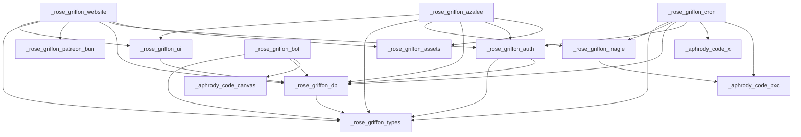

# 🗺️ Cartographie du Monorepo

Ce document cartographie la structure complète du monorepo **Rose Griffon**. Il est maintenu automatiquement et sert de source de vérité pour les développeurs et les assistants IA (Gemini, Claude) afin de comprendre les responsabilités et connexions de chaque module.

## 🚀 Applications (`apps/`)

Applications autonomes prêtes à être déployées :

### 📁 [@rose-griffon/azalee-web](file:///apps/azalee)
* **Chemin :** `apps/azalee`
* **Description :** Aucune description fournie.
* **Version :** `0.1.0`
* **Points d'entrée clés :**
  - [`app/page.tsx`](file:///apps/azalee/app/page.tsx)

* **Scripts disponibles :**
  - `bun run dev` : `bun --smol --bun node_modules/next/dist/bin/next dev --turbopack`
  - `bun run build` : `bun --smol --bun node_modules/next/dist/bin/next build --turbopack`
  - `bun run start` : `bun node_modules/next/dist/bin/next start`
  - `bun run lint` : `oxlint .`
  - `bun run lint:fix` : `oxlint --fix .`
  - `bun run format` : `oxfmt .`
  - `bun run format:check` : `oxfmt --check .`
  - `bun run type-check` : `tsc --noEmit`
  - `bun run test` : `vitest run`
  - `bun run test:run` : `vitest run`
  - `bun run create-draft` : `bun scripts/create-draft.ts`
  - `bun run backup:supabase` : `bun scripts/ops/backup-supabase-to-sqlite.ts`
  - `bun run sync:supabase` : `bun scripts/ops/sync-supabase-to-sqlite.ts`
  - `bun run sync:full` : `bun scripts/ops/sync-supabase-to-sqlite.ts --full --deletes`

* **Dépendances internes & externes :**
  - **Dependencies :** `@better-auth/agent-auth`, `@dnd-kit/core`, `@dnd-kit/sortable`, `@dnd-kit/utilities`, `@envelop/graphql-jit`, `@graphql-yoga/plugin-response-cache`, `@lexical/code`, `@lexical/file`, `@lexical/html`, `@lexical/link`, `@lexical/list`, `@lexical/markdown`, `@lexical/react`, `@lexical/rich-text`, `@lexical/table`, `@lexical/utils`, `@markdoc/markdoc`, `@radix-ui/react-accordion`, `@radix-ui/react-alert-dialog`, `@radix-ui/react-avatar`, `@radix-ui/react-checkbox`, `@radix-ui/react-collapsible`, `@radix-ui/react-dialog`, `@radix-ui/react-dropdown-menu`, `@radix-ui/react-label`, `@radix-ui/react-popover`, `@radix-ui/react-progress`, `@radix-ui/react-radio-group`, `@radix-ui/react-select`, `@radix-ui/react-separator`, `@radix-ui/react-slider`, `@radix-ui/react-slot`, `@radix-ui/react-switch`, `@radix-ui/react-tabs`, `@radix-ui/react-toggle`, `@radix-ui/react-toggle-group`, `@radix-ui/react-tooltip`, `@rose-griffon/assets`, `@rose-griffon/auth`, `@rose-griffon/db`, `@rose-griffon/inagle`, `@rose-griffon/types`, `@rose-griffon/ui`, `@sentry/nextjs`, `@supabase/supabase-js`, `@types/nodemailer`, `@vercel/analytics`, `@vercel/og`, `@vercel/speed-insights`, `bcryptjs`, `better-auth`, `cheerio`, `class-variance-authority`, `clsx`, `cmdk`, `csv-parse`, `date-fns`, `embla-carousel-react`, `googleapis`, `graphql`, `graphql-yoga`, `html-to-image`, `input-otp`, `jsonwebtoken`, `kysely`, `lexical`, `lucide-react`, `motion`, `next`, `next-themes`, `node-ipinfo`, `nodemailer`, `pg`, `radix-ui`, `react`, `react-day-picker`, `react-dom`, `react-hook-form`, `react-image-crop`, `react-konva`, `react-resizable-panels`, `recharts`, `sharp`, `sonner`, `tailwind-merge`, `use-image`, `vaul`, `wanakana`, `web-push`, `zod`
  - **DevDependencies :** `@next/bundle-analyzer`, `@playwright/test`, `@rose-griffon/config`, `@tailwindcss/postcss`, `@tailwindcss/typography`, `@testing-library/jest-dom`, `@types/bun`, `@types/jsonwebtoken`, `@types/node`, `@types/pg`, `@types/react`, `@types/react-dom`, `@types/web-push`, `@vitejs/plugin-react`, `babel-plugin-react-compiler`, `jsdom`, `oxlint`, `tailwindcss`, `tailwindcss-animate`, `turbo`, `typescript`, `vitest`

---

### 📁 [@rose-griffon/bot](file:///apps/bot)
* **Chemin :** `apps/bot`
* **Description :** Bot Discord Rose Griffon — slash commands public + admin, sync members, canvas cards
* **Version :** `0.1.0`
* **Points d'entrée clés :**
  - [`src/index.ts`](file:///apps/bot/src/index.ts)

* **Scripts disponibles :**
  - `bun run dev` : `bun --watch src/index.ts`
  - `bun run start` : `bun src/index.ts`
  - `bun run build` : `bun build src/index.ts --target=bun --packages=external --outdir=dist`
  - `bun run type-check` : `tsc --noEmit`
  - `bun run lint` : `oxlint src`
  - `bun run lint:fix` : `oxlint --fix src`
  - `bun run test` : `vitest run --passWithNoTests`
  - `bun run smoke:admin` : `bun src/scripts/smoke-admin.ts`
  - `bun run smoke:canvas` : `bun src/scripts/smoke-canvas.ts`

* **Dépendances internes & externes :**
  - **Dependencies :** `@aphrody-code/canvas`, `@rose-griffon/db`, `@rose-griffon/types`, `@rpbey/discordx`, `@supabase/supabase-js`, `discord.js`, `reflect-metadata`, `zod`
  - **DevDependencies :** `@rose-griffon/config`, `@types/bun`, `oxlint`, `typescript`, `vitest`

---

### 📁 [@rose-griffon/website](file:///apps/website)
* **Chemin :** `apps/website`
* **Description :** Aucune description fournie.
* **Version :** `1.4.0`

* **Scripts disponibles :**
  - `bun run dev` : `bun run --bun next dev`
  - `bun run test` : `vitest run`
  - `bun run test:ui` : `vitest --ui`
  - `bun run test:run` : `vitest run`
  - `bun run build` : `bun node_modules/next/dist/bin/next build`
  - `bun run start` : `bun run --bun next start`
  - `bun run lint` : `oxlint .`
  - `bun run lint:fix` : `oxlint --fix .`
  - `bun run format` : `oxfmt .`
  - `bun run format:check` : `oxfmt --check .`
  - `bun run analyze` : `ANALYZE=true next build`
  - `bun run type-check` : `tsc --noEmit`
  - `bun run clean` : `rm -rf .next .turbo dist`
  - `bun run pre-deploy` : `bun scripts/pre-deploy-check.js`
  - `bun run submit-sitemap` : `bun scripts/submit-sitemap.js`
  - `bun run supabase:types` : `supabase gen types typescript --project-id isbkaeltubqittywibeh > src/types/supabase.ts`

* **Dépendances internes & externes :**
  - **Dependencies :** `@googlemaps/js-api-loader`, `@hookform/resolvers`, `@origin-space/image-cropper`, `@radix-ui/react-accordion`, `@radix-ui/react-alert-dialog`, `@radix-ui/react-aspect-ratio`, `@radix-ui/react-avatar`, `@radix-ui/react-checkbox`, `@radix-ui/react-collapsible`, `@radix-ui/react-context-menu`, `@radix-ui/react-dialog`, `@radix-ui/react-dropdown-menu`, `@radix-ui/react-hover-card`, `@radix-ui/react-label`, `@radix-ui/react-menubar`, `@radix-ui/react-navigation-menu`, `@radix-ui/react-popover`, `@radix-ui/react-progress`, `@radix-ui/react-radio-group`, `@radix-ui/react-scroll-area`, `@radix-ui/react-select`, `@radix-ui/react-separator`, `@radix-ui/react-slider`, `@radix-ui/react-slot`, `@radix-ui/react-switch`, `@radix-ui/react-tabs`, `@radix-ui/react-toggle`, `@radix-ui/react-toggle-group`, `@radix-ui/react-tooltip`, `@rose-griffon/assets`, `@rose-griffon/auth`, `@rose-griffon/db`, `@rose-griffon/patreon-bun`, `@rose-griffon/types`, `@rose-griffon/ui`, `@sentry/nextjs`, `@stripe/stripe-js`, `@supabase/ssr`, `@supabase/supabase-js`, `@tanstack/query-sync-storage-persister`, `@tanstack/react-query`, `@tanstack/react-query-persist-client`, `@tanstack/react-table`, `@tiptap/core`, `@tiptap/extension-placeholder`, `@tiptap/starter-kit`, `@types/nodemailer`, `@types/pg`, `@types/pica`, `@vercel/analytics`, `@vercel/edge-config`, `@vercel/speed-insights`, `better-auth`, `kysely`, `browser-image-compression`, `class-variance-authority`, `clsx`, `cmdk`, `date-fns`, `discord-api-types`, `discord.js`, `embla-carousel-react`, `googleapis`, `input-otp`, `lucide-react`, `motion`, `next`, `nodemailer`, `pg`, `pica`, `react`, `react-day-picker`, `react-dom`, `react-dropzone`, `react-easy-crop`, `react-hook-form`, `react-icons`, `react-quill-new`, `react-resizable-panels`, `react-tweet`, `react-twitch-embed`, `recharts`, `schema-dts`, `sonner`, `stripe`, `swr`, `tailwind-merge`, `tw-animate-css`, `vaul`, `zod`, `zustand`
  - **DevDependencies :** `@next/bundle-analyzer`, `@rose-griffon/config`, `@tailwindcss/postcss`, `@testing-library/jest-dom`, `@testing-library/react`, `@types/google.maps`, `@types/node`, `@types/react`, `@types/react-dom`, `@vitejs/plugin-react`, `jsdom`, `oxlint`, `shadcn`, `sharp`, `tailwindcss`, `typescript`, `vitest`

---

## 📦 Packages (`packages/`)

Packages partagés consommés par les applications :

### 📁 [@rose-griffon/auth](file:///packages/auth)
* **Chemin :** `packages/auth`
* **Description :** Shared authentication logic and guards for Rose Griffon apps
* **Version :** `0.1.0`
* **Points d'entrée clés :**
  - [`src/index.ts`](file:///packages/auth/src/index.ts)

* **Scripts disponibles :**
  - `bun run type-check` : `tsc --noEmit`
  - `bun run test` : `vitest run`

* **Dépendances internes & externes :**
  - **Dependencies :** `@rose-griffon/db`, `@rose-griffon/types`, `@supabase/supabase-js`, `better-auth`, `zod`
  - **DevDependencies :** `@types/bun`, `next`, `react`, `typescript`, `vitest`

---

### 📁 [@rose-griffon/config](file:///packages/config)
* **Chemin :** `packages/config`
* **Description :** Configs partagées : tsconfig, eslint, oxlint, tailwind preset
* **Version :** `0.1.0`

* **Scripts disponibles :**
  - Aucun script disponible.

* **Dépendances internes & externes :**
  - **Dependencies :** Aucune
  - **DevDependencies :** Aucune

---

### 📁 [@rose-griffon/cron](file:///packages/cron)
* **Chemin :** `packages/cron`
* **Description :** Daemon de tâches planifiées (cron) pour la maintenance DB, CDN et API
* **Version :** `0.1.0`
* **Points d'entrée clés :**
  - [`src/index.ts`](file:///packages/cron/src/index.ts)
  - [`src/tasks/ie-crawl/index.ts`](file:///packages/cron/src/tasks/ie-crawl/index.ts)

* **Scripts disponibles :**
  - `bun run start` : `bun src/index.ts`
  - `bun run build` : `bun build src/index.ts --compile --minify --sourcemap --bytecode --format esm --outfile dist/rg-cron`
  - `bun run type-check` : `tsc --noEmit`
  - `bun run lint` : `bunx oxlint -c ../../.oxlintrc.json src`

* **Dépendances internes & externes :**
  - **Dependencies :** `@aphrody-code/bxc`, `@aphrody-code/x`, `@asteasolutions/zod-to-openapi`, `@rose-griffon/auth`, `@rose-griffon/db`, `@rose-griffon/inagle`, `@rose-griffon/types`, `cheerio`, `zod`
  - **DevDependencies :** `@types/bun`, `typescript`

---

### 📁 [@rose-griffon/types](file:///packages/types)
* **Chemin :** `packages/types`
* **Description :** Types métier partagés (roles, user, discord) — source unique de vérité bot/azalee/website
* **Version :** `0.1.0`
* **Points d'entrée clés :**
  - [`src/index.ts`](file:///packages/types/src/index.ts)

* **Scripts disponibles :**
  - Aucun script disponible.

* **Dépendances internes & externes :**
  - **Dependencies :** `zod`
  - **DevDependencies :** `@rose-griffon/config`, `typescript`

---

### 📁 [@rose-griffon/db](file:///packages/db)
* **Chemin :** `packages/db`
* **Description :** Client Supabase partagé + Database types générés (site + bot)
* **Version :** `0.1.0`
* **Points d'entrée clés :**
  - [`src/index.ts`](file:///packages/db/src/index.ts)

* **Scripts disponibles :**
  - `bun run types:gen` : `supabase gen types typescript --project-id isbkaeltubqittywibeh > src/types.gen.ts`
  - `bun run type-check` : `tsc --noEmit`
  - `bun run test` : `vitest run`

* **Dépendances internes & externes :**
  - **Dependencies :** `@rose-griffon/types`, `@supabase/ssr`, `@supabase/supabase-js`
  - **DevDependencies :** `@types/bun`, `typescript`, `vitest`

---

### 📁 [@rose-griffon/inagle](file:///packages/inagle)
* **Chemin :** `packages/inagle`
* **Description :** Universal Game Data API for Inazuma Eleven: Victory Road — parsers, types, and tools for IEVR game data
* **Version :** `1.2.0`
* **Points d'entrée clés :**
  - [`src/index.ts`](file:///packages/inagle/src/index.ts)

* **Scripts disponibles :**
  - `bun run build` : `bun run tsc -p tsconfig.build.json`
  - `bun run cli` : `bun src/cli.ts`
  - `bun run entries` : `bun src/scripts/generate-entries.ts`
  - `bun run push` : `bun src/cli-push.ts`
  - `bun run serve` : `bun src/scripts/serve-data.ts`
  - `bun run compile` : `bun src/scripts/build-standalone.ts`
  - `bun run prepublishOnly` : `bun run build`
  - `bun run test` : `bun test`
  - `bun run lint` : `bunx oxlint -c ../../.oxlintrc.json src`
  - `bun run lint:fix` : `bunx oxlint -c ../../.oxlintrc.json --fix src`
  - `bun run type-check` : `tsc --noEmit`

* **Dépendances internes & externes :**
  - **Dependencies :** `@aphrody-code/bxc`, `@leeoniya/ufuzzy`, `@streamparser/json`, `@supabase/supabase-js`, `cheerio`, `commander`, `fengari`, `hono`, `jsonwebtoken`, `kuroshiro`, `kuroshiro-analyzer-kuromoji`, `picocolors`, `web-tree-sitter`, `zod`, `zod-to-json-schema`
  - **DevDependencies :** `@types/bun`, `@types/jsonwebtoken`, `@types/node`, `@types/pg`, `typescript`, `vitest`

---

### 📁 [@rose-griffon/assets](file:///packages/assets)
* **Chemin :** `packages/assets`
* **Description :** Shared static assets for Rose Griffon apps
* **Version :** `0.1.0`

* **Scripts disponibles :**
  - Aucun script disponible.

* **Dépendances internes & externes :**
  - **Dependencies :** Aucune
  - **DevDependencies :** Aucune

---

### 📁 [@rose-griffon/ui](file:///packages/ui)
* **Chemin :** `packages/ui`
* **Description :** Composants shadcn/ui partagés (new-york style, Tailwind v4)
* **Version :** `0.1.0`
* **Points d'entrée clés :**
  - [`src/index.ts`](file:///packages/ui/src/index.ts)

* **Scripts disponibles :**
  - `bun run type-check` : `tsc --noEmit`

* **Dépendances internes & externes :**
  - **Dependencies :** `@rose-griffon/db`, `@radix-ui/react-accordion`, `@radix-ui/react-alert-dialog`, `@radix-ui/react-aspect-ratio`, `@radix-ui/react-avatar`, `@radix-ui/react-checkbox`, `@radix-ui/react-collapsible`, `@radix-ui/react-context-menu`, `@radix-ui/react-dialog`, `@radix-ui/react-dropdown-menu`, `@radix-ui/react-hover-card`, `@radix-ui/react-label`, `@radix-ui/react-menubar`, `@radix-ui/react-navigation-menu`, `@radix-ui/react-popover`, `@radix-ui/react-progress`, `@radix-ui/react-radio-group`, `@radix-ui/react-scroll-area`, `@radix-ui/react-select`, `@radix-ui/react-separator`, `@radix-ui/react-slider`, `@radix-ui/react-slot`, `@radix-ui/react-switch`, `@radix-ui/react-tabs`, `@radix-ui/react-toggle`, `@radix-ui/react-toggle-group`, `@radix-ui/react-tooltip`, `@tanstack/react-table`, `class-variance-authority`, `clsx`, `cmdk`, `date-fns`, `embla-carousel-react`, `input-otp`, `lucide-react`, `next-themes`, `react-day-picker`, `react-hook-form`, `react-resizable-panels`, `recharts`, `sonner`, `tailwind-merge`, `vaul`
  - **DevDependencies :** `@types/bun`, `@types/react`, `@types/react-dom`, `tailwindcss`, `typescript`

---

### 📁 [@rose-griffon/patreon-bun](file:///packages/patreon-bun)
* **Chemin :** `packages/patreon-bun`
* **Description :** Bun-only TypeScript library for the V2 Patreon API. Fork of patreon-api.ts (ghostrider-05) for Rose Griffon.
* **Version :** `0.20.1`
* **Points d'entrée clés :**
  - [`src/index.ts`](file:///packages/patreon-bun/src/index.ts)

* **Scripts disponibles :**
  - `bun run build:js` : `bun build src/index.ts --outdir dist --target bun --format esm`
  - `bun run build:types` : `tsc --emitDeclarationOnly --noCheck`
  - `bun run build` : `bun run build:js && bun run build:types`
  - `bun run prepublishOnly` : `bun run build`

* **Dépendances internes & externes :**
  - **Dependencies :** Aucune
  - **DevDependencies :** `@types/bun`, `msw`, `openapi-types`, `ts-morph`, `typescript`

---

## 🔄 Dépendances croisées (Workspace Dependencies)

Voici les relations d'importation interne au sein du monorepo :

