# 🗺️ Cartographie du Monorepo

Ce document cartographie la structure complète du monorepo **Rose Griffon**. Il est maintenu automatiquement et sert de source de vérité pour les développeurs et les assistants IA (Gemini, Claude) afin de comprendre les responsabilités et connexions de chaque module.

## 🚀 Applications (`apps/`)

Applications autonomes prêtes à être déployées :

### 📁 [cdn](file:///apps/cdn)
* **Chemin :** `apps/cdn`
* **Description :** Aucune description fournie.
* **Version :** `0.1.0`

* **Scripts disponibles :**
  - `bun run type-check` : `bun --bun tsc --noEmit`
  - `bun run test` : `bun test .`
  - `bun run start` : `bun server.ts`
  - `bun run dev` : `bun --watch server.ts`

* **Dépendances internes & externes :**
  - **Dependencies :** Aucune
  - **DevDependencies :** `@types/bun`, `typescript`

---

### 📁 [@rosegriffon/achillea-bot](file:///apps/achillea-bot)
* **Chemin :** `apps/achillea-bot`
* **Description :** Achillea Backend — Bot Discord + API REST + WebSocket pour la plateforme Achillea (Bun + Ts.ED + MikroORM 7)
* **Version :** `1.0.7`
* **Points d'entrée clés :**
  - [`src/main.ts`](file:///apps/achillea-bot/src/main.ts)

* **Scripts disponibles :**
  - `bun run build` : `bun run build:clean && bun run build:compile && bun run build:ranked && bun run install:plugins`
  - `bun run build:clean` : `bun scripts/clean-build.ts`
  - `bun run build:compile` : `tsc --project tsconfig.json --skipLibCheck && bun run build:alias`
  - `bun run build:ranked` : `bun build src/ranked/main.ts --target=bun --format=esm --outdir=build/ranked --sourcemap=external`
  - `bun run build:alias` : `tsc-alias -p tsconfig.json`
  - `bun run build:start` : `bun run build && bun run start`
  - `bun run install:plugins` : `installoop --rootDir=./build/plugins`
  - `bun run type:check` : `tsc --pretty --skipLibCheck --noEmit`
  - `bun run type-check` : `tsc --pretty --skipLibCheck --noEmit`
  - `bun run format` : `oxfmt .`
  - `bun run format:check` : `oxfmt --check .`
  - `bun run clean` : `bun scripts/clean-build.ts`
  - `bun run start` : `NODE_ENV=production bun build/main.js`
  - `bun run dev` : `NODE_ENV=development bun --watch src/main.ts`
  - `bun run i18n` : `typesafe-i18n`
  - `bun run migration:create:dev` : `NODE_ENV=development SKIP_SCHEDULE=1 bunx mikro-orm migration:create`
  - `bun run migration:up:dev` : `NODE_ENV=development SKIP_SCHEDULE=1 bunx mikro-orm migration:up`
  - `bun run migration:down:dev` : `NODE_ENV=development SKIP_SCHEDULE=1 bunx mikro-orm migration:down`
  - `bun run schema:update:dev` : `NODE_ENV=development SKIP_SCHEDULE=1 bunx mikro-orm schema:update --dump`
  - `bun run cache:clear:dev` : `NODE_ENV=development SKIP_SCHEDULE=1 bunx mikro-orm cache:clear`
  - `bun run migration:create:prod` : `NODE_ENV=production SKIP_SCHEDULE=1 bunx mikro-orm migration:create`
  - `bun run migration:up:prod` : `NODE_ENV=production SKIP_SCHEDULE=1 bunx mikro-orm migration:up`
  - `bun run migration:down:prod` : `NODE_ENV=production SKIP_SCHEDULE=1 bunx mikro-orm migration:down`
  - `bun run plugins:install` : `installoop --rootDir=./src/plugins`
  - `bun run postinstall` : `bun run plugins:install`
  - `bun run lint` : `oxlint --config ../../.oxlintrc.json --allow import/no-cycle .`
  - `bun run lint:strict` : `oxlint --config ../../.oxlintrc.json --allow import/no-cycle --type-aware .`
  - `bun run lint:fix` : `oxlint --config ../../.oxlintrc.json --allow import/no-cycle --fix .`
  - `bun run lint:eslint` : `eslint .`
  - `bun run test` : `bun test --isolate`
  - `bun run test:concurrent` : `bun test --isolate --concurrent`
  - `bun run test:bail` : `bun test --isolate --bail=1`
  - `bun run test:watch` : `bun test --watch`
  - `bun run test:coverage` : `bun test --isolate --coverage --coverage-reporter=text --coverage-reporter=lcov`
  - `bun run test:ci` : `bun test --isolate --reporter=junit --reporter-outfile=./bun.xml --bail=10`
  - `bun run test:e2e` : `bun test tests/e2e/`
  - `bun run test:db` : `bun test tests/db/`
  - `bun run test:unit` : `bun test tests/unit/`
  - `bun run test:supabase` : `bun test tests/supabase/`
  - `bun run test:snapshot` : `bun test tests/db/ tests/supabase/snapshot.test.ts`
  - `bun run elo:backfill-tournaments` : `bun scripts/backfill-tournament-elo.ts`
  - `bun run elo:backfill-tournaments:apply` : `bun scripts/backfill-tournament-elo.ts --apply`

* **Dépendances internes & externes :**
  - **Dependencies :** `@rosegriffon/achillea-core`, `@rosegriffon/achillea-types`, `@aphrody/canvas`, `@aphrody/discordx`, `@aphrody/importer`, `@aphrody/pagination`, `@aphrody/utilities`, `@casl/ability`, `@colyseus/bun-websockets`, `@colyseus/schema`, `@mikro-orm/cli`, `@mikro-orm/core`, `@mikro-orm/decorators`, `@mikro-orm/entity-generator`, `@mikro-orm/migrations`, `@mikro-orm/postgresql`, `@mikro-orm/sql-highlighter`, `@mikro-orm/sqlite`, `@rushstack/node-core-library`, `@sindresorhus/transliterate`, `@supabase/supabase-js`, `@tsed/common`, `@tsed/core`, `@tsed/di`, `@tsed/exceptions`, `@tsed/json-mapper`, `@tsed/platform-express`, `@tsed/platform-middlewares`, `@tsed/schema`, `@tsed/socketio`, `@tsed/swagger`, `@types/cookie-parser`, `@types/jsonwebtoken`, `@types/luxon`, `@types/multer`, `@types/socket.io`, `@types/unidecode`, `archiver`, `axios`, `blockhash-core`, `body-parser`, `boxen`, `brackets-manager`, `brackets-model`, `bullmq`, `case`, `chalk`, `chokidar`, `class-transformer`, `colyseus`, `cookie-parser`, `cron`, `cron-validator`, `dayjs`, `discord-api-types`, `discord-logs`, `discord-oauth2`, `discord.js`, `dotenv`, `encodeurl`, `envalid`, `express`, `fast-folder-size`, `grapheme-splitter`, `http-proxy-middleware`, `http-status-codes`, `installoop`, `ioredis`, `jsonwebtoken`, `luxon`, `merkletreejs`, `multer`, `node-os-utils`, `ora`, `pdf-lib`, `pidusage`, `puppeteer`, `qrcode`, `reflect-metadata`, `rxeta`, `rxjs`, `saveqlite`, `semver`, `sharp`, `socket.io`, `stacktrace-parser`, `swagger-ui-express`, `ts-toolbelt`, `tsyringe`, `typesafe-i18n`, `unidecode`, `unpipe`, `uuid`, `zod`
  - **DevDependencies :** `@antfu/eslint-config`, `@types/archiver`, `@types/body-parser`, `@types/bun`, `@types/dateformat`, `@types/express`, `@types/node`, `@types/node-os-utils`, `@types/pidusage`, `@types/qrcode`, `@types/semver`, `@types/swagger-ui-express`, `eslint-plugin-simple-import-sort`, `jiti`, `ncp`, `oxlint`, `oxlint-tsgolint`, `tsc-alias`, `tsconfig-paths`, `typescript`

---

### 📁 [@rosegriffon/bot](file:///apps/bot)
* **Chemin :** `apps/bot`
* **Description :** Bot Discord Rose Griffon — slash commands public + admin, sync members, canvas cards
* **Version :** `0.2.0`
* **Points d'entrée clés :**
  - [`src/index.ts`](file:///apps/bot/src/index.ts)

* **Scripts disponibles :**
  - `bun run dev` : `bun --watch src/index.ts`
  - `bun run start` : `bun src/index.ts`
  - `bun run build` : `bun build src/index.ts --target=bun --packages=external --outdir=dist`
  - `bun run type-check` : `bun --bun tsc --noEmit`
  - `bun run lint` : `oxlint src`
  - `bun run lint:fix` : `oxlint --fix src`
  - `bun run test` : `bun test src`
  - `bun run smoke:admin` : `bun src/scripts/smoke-admin.ts`
  - `bun run smoke:canvas` : `bun src/scripts/smoke-canvas.ts`

* **Dépendances internes & externes :**
  - **Dependencies :** `@rosegriffon/achillea-client`, `@aphrody-code/canvas`, `@rosegriffon/azalee`, `@rosegriffon/db`, `@rosegriffon/types`, `@rosegriffon/ui`, `@rpbey/discordx`, `@supabase/supabase-js`, `discord.js`, `reflect-metadata`, `zod`
  - **DevDependencies :** `@rosegriffon/config`, `@types/bun`, `oxlint`, `typescript`

---

### 📁 [@rosegriffon/website](file:///apps/website)
* **Chemin :** `apps/website`
* **Description :** Aucune description fournie.
* **Version :** `1.4.0`

* **Scripts disponibles :**
  - `bun run dev` : `bun run --bun next dev`
  - `bun run test` : `bun test src`
  - `bun run test:ui` : `bun --bun vitest --ui`
  - `bun run test:run` : `bun --bun vitest run`
  - `bun run build` : `bash ../../scripts/next-build.sh`
  - `bun run start` : `bun run --bun next start`
  - `bun run lint` : `oxlint -A style -A pedantic -A restriction -A react/react-in-jsx-scope -A unicorn/consistent-function-scoping -A promise/no-multiple-resolved -A react-perf . && eslint .`
  - `bun run lint:fix` : `oxlint -A style -A pedantic -A restriction -A react/react-in-jsx-scope -A unicorn/consistent-function-scoping -A promise/no-multiple-resolved -A react-perf --fix . && eslint --fix .`
  - `bun run format` : `oxfmt .`
  - `bun run format:check` : `oxfmt --check .`
  - `bun run analyze` : `ANALYZE=true next build`
  - `bun run type-check` : `bun --bun tsc --noEmit`
  - `bun run clean` : `rm -rf .next .turbo dist`

* **Dépendances internes & externes :**
  - **Dependencies :** `@better-auth/agent-auth`, `@colyseus/sdk`, `@dnd-kit/core`, `@dnd-kit/sortable`, `@dnd-kit/utilities`, `@envelop/graphql-jit`, `@googlemaps/js-api-loader`, `@graphql-yoga/plugin-response-cache`, `@hookform/resolvers`, `@lexical/code`, `@lexical/file`, `@lexical/html`, `@lexical/link`, `@lexical/list`, `@lexical/markdown`, `@lexical/react`, `@lexical/rich-text`, `@lexical/table`, `@lexical/utils`, `@markdoc/markdoc`, `@next/third-parties`, `@origin-space/image-cropper`, `@pixiv/three-vrm`, `@radix-ui/react-accordion`, `@radix-ui/react-alert-dialog`, `@radix-ui/react-aspect-ratio`, `@radix-ui/react-avatar`, `@radix-ui/react-checkbox`, `@radix-ui/react-collapsible`, `@radix-ui/react-context-menu`, `@radix-ui/react-dialog`, `@radix-ui/react-dropdown-menu`, `@radix-ui/react-hover-card`, `@radix-ui/react-label`, `@radix-ui/react-menubar`, `@radix-ui/react-navigation-menu`, `@radix-ui/react-popover`, `@radix-ui/react-progress`, `@radix-ui/react-radio-group`, `@radix-ui/react-scroll-area`, `@radix-ui/react-select`, `@radix-ui/react-separator`, `@radix-ui/react-slider`, `@radix-ui/react-slot`, `@radix-ui/react-switch`, `@radix-ui/react-tabs`, `@radix-ui/react-toggle`, `@radix-ui/react-toggle-group`, `@radix-ui/react-tooltip`, `@react-three/drei`, `@react-three/fiber`, `@react-three/postprocessing`, `@rosegriffon/achillea-client`, `@rosegriffon/achillea-core`, `@rosegriffon/achillea-types`, `@rosegriffon/app-shell`, `@rosegriffon/assets`, `@rosegriffon/auth`, `@rosegriffon/azalee`, `@rosegriffon/db`, `@rosegriffon/i18n`, `@rosegriffon/inagle`, `@rosegriffon/inagle-cross`, `@rosegriffon/patreon-bun`, `@rosegriffon/preferences`, `@rosegriffon/search`, `@rosegriffon/types`, `@rosegriffon/ui`, `@sentry/nextjs`, `@spacedrive/primitives`, `@spacedrive/tokens`, `@stripe/stripe-js`, `@supabase/ssr`, `@supabase/supabase-js`, `@tanstack/query-sync-storage-persister`, `@tanstack/react-query`, `@tanstack/react-query-persist-client`, `@tanstack/react-table`, `@theatre/core`, `@theatre/r3f`, `@tiptap/core`, `@tiptap/extension-placeholder`, `@tiptap/starter-kit`, `@types/nodemailer`, `@types/pg`, `@types/pica`, `bcryptjs`, `better-auth`, `browser-image-compression`, `cheerio`, `class-variance-authority`, `clsx`, `cmdk`, `csv-parse`, `date-fns`, `discord-api-types`, `discord.js`, `drizzle-orm`, `embla-carousel-react`, `googleapis`, `graphql`, `graphql-yoga`, `html-to-image`, `input-otp`, `jsonwebtoken`, `kysely`, `lexical`, `lucide-react`, `motion`, `mp4-muxer`, `next`, `next-themes`, `node-ipinfo`, `nodemailer`, `pg`, `pica`, `radix-ui`, `react`, `react-arborist`, `react-day-picker`, `react-dom`, `react-dropzone`, `react-easy-crop`, `react-hook-form`, `react-icons`, `react-image-crop`, `react-konva`, `react-quill-new`, `react-resizable-panels`, `react-tweet`, `react-twitch-embed`, `recharts`, `schema-dts`, `sonner`, `stripe`, `swr`, `tailwind-merge`, `three`, `tw-animate-css`, `use-image`, `vaul`, `wanakana`, `web-push`, `zod`, `zustand`
  - **DevDependencies :** `@next/bundle-analyzer`, `@rosegriffon/config`, `@tailwindcss/postcss`, `@tailwindcss/typography`, `@testing-library/jest-dom`, `@testing-library/react`, `@theatre/studio`, `@types/google.maps`, `@types/jsonwebtoken`, `@types/node`, `@types/react`, `@types/react-dom`, `@types/three`, `@types/web-push`, `@vitejs/plugin-react`, `@webgpu/types`, `babel-plugin-react-compiler`, `drizzle-kit`, `jsdom`, `oxlint`, `shadcn`, `sharp`, `tailwindcss`, `tailwindcss-animate`, `typescript`, `vitest`

---

### 📁 [realtime](file:///apps/realtime)
* **Chemin :** `apps/realtime`
* **Description :** Aucune description fournie.
* **Version :** `0.1.0`

* **Scripts disponibles :**
  - `bun run type-check` : `bun --bun tsc --noEmit`
  - `bun run start` : `bun server.ts`
  - `bun run dev` : `bun --watch server.ts`

* **Dépendances internes & externes :**
  - **Dependencies :** `pg`
  - **DevDependencies :** `@types/bun`, `@types/pg`, `typescript`

---

### 📁 [storage](file:///apps/storage)
* **Chemin :** `apps/storage`
* **Description :** Aucune description fournie.
* **Version :** `0.1.0`

* **Scripts disponibles :**
  - `bun run type-check` : `bun --bun tsc --noEmit`
  - `bun run test` : `bun test .`
  - `bun run start` : `bun server.ts`
  - `bun run dev` : `bun --watch server.ts`

* **Dépendances internes & externes :**
  - **Dependencies :** Aucune
  - **DevDependencies :** `@types/bun`, `typescript`

---

## 📦 Packages (`packages/`)

Packages partagés consommés par les applications :

### 📁 [@rosegriffon/identity](file:///packages/identity)
* **Chemin :** `packages/identity`
* **Description :** Compte unique Rose Griffon : identité native et connexions liées (Discord, Patreon, Twitch, Google, Steam, Achilléa)
* **Version :** `0.1.0`
* **Points d'entrée clés :**
  - [`src/index.ts`](file:///packages/identity/src/index.ts)

* **Scripts disponibles :**
  - `bun run lint` : `bunx oxlint -c ../../.oxlintrc.json src`
  - `bun run type-check` : `bun --bun tsc --noEmit`
  - `bun run test` : `bun test test`

* **Dépendances internes & externes :**
  - **Dependencies :** Aucune
  - **DevDependencies :** Aucune

---

### 📁 [@rosegriffon/azalee](file:///packages/azalee)
* **Chemin :** `packages/azalee`
* **Description :** Bibliothèque Bun du wiki Azalée (Inazuma Eleven: Victory Road) — accès données via miroir SQLite, index CPK, index de texte de jeu, résolution d'URLs CDN, recherche floue et CLI.
* **Version :** `1.0.1`
* **Points d'entrée clés :**
  - [`src/index.ts`](file:///packages/azalee/src/index.ts)

* **Scripts disponibles :**
  - `bun run build` : `bun --bun tsc -p tsconfig.build.json && bun scripts/copy-data.ts`
  - `bun run cli` : `bun src/cli.ts`
  - `bun run compile` : `bun scripts/build-standalone.ts`
  - `bun run serve` : `bun src/cli.ts serve`
  - `bun run sync:entries` : `bun scripts/sync-inagle-entries.ts`
  - `bun run test` : `bun test`
  - `bun run lint` : `bunx oxlint -c ../../.oxlintrc.json -A style -A pedantic -A restriction src`
  - `bun run lint:fix` : `bunx oxlint -c ../../.oxlintrc.json -A style -A pedantic -A restriction --fix src`
  - `bun run type-check` : `bun --bun tsc --noEmit`
  - `bun run clean` : `rm -rf dist *.tsbuildinfo`
  - `bun run prepublishOnly` : `bun run build`

* **Dépendances internes & externes :**
  - **Dependencies :** `@rosegriffon/db`, `@rosegriffon/inagle`, `@supabase/supabase-js`, `commander`, `drizzle-orm`, `wanakana`
  - **DevDependencies :** `@happy-dom/global-registrator`, `@rosegriffon/config`, `@types/bun`, `@types/node`, `oxlint`, `typescript`

---

### 📁 [@rosegriffon/auth](file:///packages/auth)
* **Chemin :** `packages/auth`
* **Description :** Shared authentication logic and guards for Rose Griffon apps
* **Version :** `0.1.2`
* **Points d'entrée clés :**
  - [`src/index.ts`](file:///packages/auth/src/index.ts)

* **Scripts disponibles :**
  - `bun run type-check` : `bun --bun tsc --noEmit`
  - `bun run test` : `bun test src`
  - `bun run lint` : `bunx oxlint -c ../../.oxlintrc.json src`

* **Dépendances internes & externes :**
  - **Dependencies :** `@rosegriffon/db`, `@rosegriffon/types`, `@supabase/supabase-js`, `better-auth`, `zod`
  - **DevDependencies :** `@types/bun`, `next`, `react`, `typescript`, `vitest`

---

### 📁 [@rosegriffon/config](file:///packages/config)
* **Chemin :** `packages/config`
* **Description :** Configs partagées : tsconfig, eslint, oxlint, tailwind preset
* **Version :** `0.1.2`

* **Scripts disponibles :**
  - `bun run lint` : `bunx oxlint -c ../../.oxlintrc.json .`

* **Dépendances internes & externes :**
  - **Dependencies :** Aucune
  - **DevDependencies :** Aucune

---

### 📁 [@rosegriffon/cron](file:///packages/cron)
* **Chemin :** `packages/cron`
* **Description :** Daemon de tâches planifiées (cron) pour la maintenance DB, CDN et API
* **Version :** `0.1.0`
* **Points d'entrée clés :**
  - [`src/index.ts`](file:///packages/cron/src/index.ts)
  - [`src/tasks/ie-crawl/index.ts`](file:///packages/cron/src/tasks/ie-crawl/index.ts)

* **Scripts disponibles :**
  - `bun run test` : `bun test src`
  - `bun run start` : `bun src/index.ts`
  - `bun run build` : `bun build src/index.ts --compile --minify --sourcemap --bytecode --format esm --external @aphrody-code/bxc --external @aphrody-code/bxc/google --external @aphrody-code/bxc/internal/html-utils --outfile dist/rg-cron`
  - `bun run type-check` : `bun --bun tsc -p tsconfig.typecheck.json --noEmit`
  - `bun run lint` : `bunx oxlint -c ../../.oxlintrc.json src`

* **Dépendances internes & externes :**
  - **Dependencies :** `@aphrody-code/bxc`, `@aphrody-code/x`, `@aphrody-code/zukan`, `@asteasolutions/zod-to-openapi`, `@rosegriffon/auth`, `@rosegriffon/db`, `@rosegriffon/inagle`, `@rosegriffon/types`, `cheerio`, `discord.js`, `zod`
  - **DevDependencies :** `@types/bun`, `typescript`

---

### 📁 [@rosegriffon/app-shell](file:///packages/app-shell)
* **Chemin :** `packages/app-shell`
* **Description :** Chrome applicatif partagé de website (navigation, barre latérale, barre supérieure, pied de page)
* **Version :** `0.1.0`
* **Points d'entrée clés :**
  - [`src/index.ts`](file:///packages/app-shell/src/index.ts)

* **Scripts disponibles :**
  - `bun run lint` : `bunx oxlint -c ../../.oxlintrc.json src`
  - `bun run type-check` : `bun --bun tsc --noEmit`
  - `bun run test` : `bun test test`

* **Dépendances internes & externes :**
  - **Dependencies :** `@rosegriffon/ui`, `lucide-react`, `next-themes`
  - **DevDependencies :** `@rosegriffon/config`, `@types/bun`, `@types/react`, `@types/react-dom`, `next`, `react`, `react-dom`, `typescript`

---

### 📁 [@rosegriffon/types](file:///packages/types)
* **Chemin :** `packages/types`
* **Description :** Types métier partagés (roles, user, discord) — source unique de vérité bot/azalee/website
* **Version :** `0.2.2`
* **Points d'entrée clés :**
  - [`src/index.ts`](file:///packages/types/src/index.ts)

* **Scripts disponibles :**
  - `bun run test` : `bun test src`
  - `bun run lint` : `bunx oxlint -c ../../.oxlintrc.json src`
  - `bun run type-check` : `bun --bun tsc --noEmit`

* **Dépendances internes & externes :**
  - **Dependencies :** `zod`
  - **DevDependencies :** `@rosegriffon/config`, `typescript`

---

### 📁 [@rosegriffon/inagle-cross](file:///packages/inagle-cross)
* **Chemin :** `packages/inagle-cross`
* **Description :** API de données et de rétro-conception pour Inazuma Eleven Cross — types, schémas, et analyseurs d'assets
* **Version :** `0.1.1`
* **Points d'entrée clés :**
  - [`src/index.ts`](file:///packages/inagle-cross/src/index.ts)

* **Scripts disponibles :**
  - `bun run type-check` : `bun --bun tsc --noEmit`
  - `bun run lint` : `bunx oxlint -c ../../.oxlintrc.json src`

* **Dépendances internes & externes :**
  - **Dependencies :** `zod`
  - **DevDependencies :** `@types/node`, `typescript`

---

### 📁 [@rosegriffon/db](file:///packages/db)
* **Chemin :** `packages/db`
* **Description :** Client Supabase partagé + Database types générés (site + bot)
* **Version :** `0.2.2`
* **Points d'entrée clés :**
  - [`src/index.ts`](file:///packages/db/src/index.ts)

* **Scripts disponibles :**
  - `bun run types:gen` : `bun scripts/types-gen.ts`
  - `bun run type-check` : `bun --bun tsc --noEmit`
  - `bun run test` : `bun test`
  - `bun run lint` : `bunx oxlint -c ../../.oxlintrc.json src`

* **Dépendances internes & externes :**
  - **Dependencies :** `@rosegriffon/types`, `@supabase/ssr`, `@supabase/supabase-js`
  - **DevDependencies :** `@types/bun`, `typescript`, `vitest`

---

### 📁 [@rosegriffon/inagle](file:///packages/inagle)
* **Chemin :** `packages/inagle`
* **Description :** Universal Game Data API for Inazuma Eleven: Victory Road — parsers, types, and tools for IEVR game data
* **Version :** `2.0.3`
* **Points d'entrée clés :**
  - [`src/index.ts`](file:///packages/inagle/src/index.ts)

* **Scripts disponibles :**
  - `bun run build` : `bun --bun tsc -p tsconfig.build.json`
  - `bun run cli` : `bun src/cli.ts`
  - `bun run push` : `bun src/cli.ts push`
  - `bun run prepublishOnly` : `bun run build`
  - `bun run test` : `bun test`
  - `bun run lint` : `bunx oxlint -c ../../.oxlintrc.json -A style -A pedantic -A restriction src`
  - `bun run lint:fix` : `bunx oxlint -c ../../.oxlintrc.json -A style -A pedantic -A restriction --fix src`
  - `bun run type-check` : `bun --bun tsc -p tsconfig.build.json --noEmit`

* **Dépendances internes & externes :**
  - **Dependencies :** `@aphrody-code/bxc`, `@aphrody-code/zukan`, `@leeoniya/ufuzzy`, `@streamparser/json`, `@supabase/supabase-js`, `cheerio`, `commander`, `dotenv`, `fengari`, `hono`, `jsonwebtoken`, `kuroshiro`, `kuroshiro-analyzer-kuromoji`, `pg`, `picocolors`, `web-tree-sitter`, `zod`, `zod-to-json-schema`
  - **DevDependencies :** `@types/bun`, `@types/jsonwebtoken`, `@types/node`, `@types/pg`, `typescript`, `vitest`

---

### 📁 [@rosegriffon/search](file:///packages/search)
* **Chemin :** `packages/search`
* **Description :** Recherche unifiée sur les trois domaines du réseau : association, wiki Azalée, e-sport Achilléa
* **Version :** `0.1.0`
* **Points d'entrée clés :**
  - [`src/index.ts`](file:///packages/search/src/index.ts)

* **Scripts disponibles :**
  - `bun run lint` : `bunx oxlint -c ../../.oxlintrc.json src`
  - `bun run type-check` : `bun --bun tsc --noEmit`
  - `bun run test` : `bun test test`

* **Dépendances internes & externes :**
  - **Dependencies :** Aucune
  - **DevDependencies :** Aucune

---

### 📁 [@rosegriffon/i18n](file:///packages/i18n)
* **Chemin :** `packages/i18n`
* **Description :** Noyau i18n pur Rose Griffon : locales BCP-47, négociation, replis et formatage Intl
* **Version :** `0.1.0`
* **Points d'entrée clés :**
  - [`src/index.ts`](file:///packages/i18n/src/index.ts)

* **Scripts disponibles :**
  - `bun run lint` : `bunx oxlint -c ../../.oxlintrc.json -A style -A pedantic -A restriction src test`
  - `bun run type-check` : `bun --bun tsc --noEmit`
  - `bun run test` : `bun test test`

* **Dépendances internes & externes :**
  - **Dependencies :** Aucune
  - **DevDependencies :** Aucune

---

### 📁 [@rosegriffon/assets](file:///packages/assets)
* **Chemin :** `packages/assets`
* **Description :** Shared static assets for Rose Griffon apps
* **Version :** `0.1.2`

* **Scripts disponibles :**
  - Aucun script disponible.

* **Dépendances internes & externes :**
  - **Dependencies :** Aucune
  - **DevDependencies :** Aucune

---

### 📁 [@rosegriffon/achillea-contract](file:///packages/achillea-contract)
* **Chemin :** `packages/achillea-contract`
* **Description :** Contrat Achilléa exporté en JSON Schema et en types natifs (Rust, Swift, Kotlin) — la brique qui rend le domaine portable hors TypeScript
* **Version :** `0.1.0`
* **Points d'entrée clés :**
  - [`src/index.ts`](file:///packages/achillea-contract/src/index.ts)

* **Scripts disponibles :**
  - `bun run generate` : `bun src/cli.ts`
  - `bun run check` : `bun src/cli.ts --check`
  - `bun run lint` : `bunx oxlint -c ../../.oxlintrc.json -A style -A pedantic -A restriction src tests`
  - `bun run type-check` : `bun --bun tsc --noEmit`
  - `bun run test` : `bun test tests`

* **Dépendances internes & externes :**
  - **Dependencies :** `@rosegriffon/achillea-types`
  - **DevDependencies :** `@types/bun`, `oxlint`, `typescript`

---

### 📁 [@rosegriffon/ui](file:///packages/ui)
* **Chemin :** `packages/ui`
* **Description :** Composants shadcn/ui partagés (new-york style, Tailwind v4)
* **Version :** `0.2.2`
* **Points d'entrée clés :**
  - [`src/index.ts`](file:///packages/ui/src/index.ts)

* **Scripts disponibles :**
  - `bun run lint` : `bunx oxlint -c ../../.oxlintrc.json src`
  - `bun run type-check` : `bun --bun tsc --noEmit`
  - `bun run test` : `bun test test`
  - `bun run tokens` : `bun scripts/generer-tokens.ts`

* **Dépendances internes & externes :**
  - **Dependencies :** `@hookform/resolvers`, `@radix-ui/react-accordion`, `@radix-ui/react-alert-dialog`, `@radix-ui/react-aspect-ratio`, `@radix-ui/react-avatar`, `@radix-ui/react-checkbox`, `@radix-ui/react-collapsible`, `@radix-ui/react-context-menu`, `@radix-ui/react-dialog`, `@radix-ui/react-dropdown-menu`, `@radix-ui/react-hover-card`, `@radix-ui/react-label`, `@radix-ui/react-menubar`, `@radix-ui/react-navigation-menu`, `@radix-ui/react-popover`, `@radix-ui/react-progress`, `@radix-ui/react-radio-group`, `@radix-ui/react-scroll-area`, `@radix-ui/react-select`, `@radix-ui/react-separator`, `@radix-ui/react-slider`, `@radix-ui/react-slot`, `@radix-ui/react-switch`, `@radix-ui/react-tabs`, `@radix-ui/react-toggle`, `@radix-ui/react-toggle-group`, `@radix-ui/react-tooltip`, `@rosegriffon/db`, `@rosegriffon/preferences`, `@rosegriffon/types`, `@tanstack/react-table`, `class-variance-authority`, `clsx`, `cmdk`, `date-fns`, `embla-carousel-react`, `input-otp`, `lucide-react`, `next-themes`, `qrcode-generator`, `react-day-picker`, `react-hook-form`, `react-resizable-panels`, `recharts`, `sonner`, `tailwind-merge`, `vaul`, `zod`
  - **DevDependencies :** `@types/bun`, `@types/react`, `@types/react-dom`, `tailwindcss`, `typescript`

---

### 📁 [@rosegriffon/achillea-client](file:///packages/achillea-client)
* **Chemin :** `packages/achillea-client`
* **Description :** Versioned HTTP client and runtime contracts for the Achillea guild API
* **Version :** `0.1.0`
* **Points d'entrée clés :**
  - [`src/index.ts`](file:///packages/achillea-client/src/index.ts)

* **Scripts disponibles :**
  - `bun run lint` : `bunx oxlint -c ../../.oxlintrc.json -A style -A pedantic -A restriction src tests`
  - `bun run type-check` : `bun --bun tsc --noEmit`
  - `bun run test` : `bun test tests`

* **Dépendances internes & externes :**
  - **Dependencies :** `@rosegriffon/achillea-types`, `zod`
  - **DevDependencies :** `@types/bun`, `oxlint`, `typescript`

---

### 📁 [@rosegriffon/achillea-types](file:///packages/achillea-types)
* **Chemin :** `packages/achillea-types`
* **Description :** Contrats d'API partagés (DTO + enums) — source unique pour le bot et le web
* **Version :** `0.0.0`
* **Points d'entrée clés :**
  - [`src/index.ts`](file:///packages/achillea-types/src/index.ts)

* **Scripts disponibles :**
  - `bun run lint` : `bunx oxlint -c ../../.oxlintrc.json -A style -A pedantic -A restriction src test`
  - `bun run type-check` : `bun --bun tsc --noEmit`
  - `bun run test` : `bun test test`

* **Dépendances internes & externes :**
  - **Dependencies :** Aucune
  - **DevDependencies :** `@types/bun`, `brackets-model`, `oxlint`, `typescript`

---

### 📁 [@rosegriffon/preferences](file:///packages/preferences)
* **Chemin :** `packages/preferences`
* **Description :** Pure cross-runtime resolution of Rose Griffon presentation preferences
* **Version :** `0.1.0`
* **Points d'entrée clés :**
  - [`src/index.ts`](file:///packages/preferences/src/index.ts)

* **Scripts disponibles :**
  - `bun run lint` : `bunx oxlint -c ../../.oxlintrc.json src`
  - `bun run type-check` : `bun --bun tsc --noEmit`
  - `bun run test` : `bun test test`

* **Dépendances internes & externes :**
  - **Dependencies :** Aucune
  - **DevDependencies :** Aucune

---

### 📁 [@rosegriffon/patreon-bun](file:///packages/patreon-bun)
* **Chemin :** `packages/patreon-bun`
* **Description :** Bun-only TypeScript library for the V2 Patreon API. Fork of patreon-api.ts (ghostrider-05) for Rose Griffon.
* **Version :** `0.20.3`
* **Points d'entrée clés :**
  - [`src/index.ts`](file:///packages/patreon-bun/src/index.ts)

* **Scripts disponibles :**
  - `bun run test` : `bun test src`
  - `bun run build:js` : `bun build src/index.ts --outdir dist --target bun --format esm`
  - `bun run build:types` : `bun --bun tsc --emitDeclarationOnly --noCheck`
  - `bun run build` : `bun run build:js && bun run build:types`
  - `bun run prepublishOnly` : `bun run build`
  - `bun run type-check` : `bun --bun tsc --noEmit`
  - `bun run lint` : `bunx oxlint -c ../../.oxlintrc.json -A style -A pedantic -A restriction src`

* **Dépendances internes & externes :**
  - **Dependencies :** Aucune
  - **DevDependencies :** `@types/bun`, `msw`, `openapi-types`, `ts-morph`, `typescript`

---

### 📁 [@rosegriffon/achillea-core](file:///packages/achillea-core)
* **Chemin :** `packages/achillea-core`
* **Description :** Logique métier portable (multi-runtime : navigateur, edge Deno/Web, Node, Bun) — Elo, classement, sanctions, licences, votes, validation. Aucune dépendance Discord / ORM / DI.
* **Version :** `0.0.2`
* **Points d'entrée clés :**
  - [`src/index.ts`](file:///packages/achillea-core/src/index.ts)

* **Scripts disponibles :**
  - `bun run lint` : `bunx oxlint -c ../../.oxlintrc.json -A style -A pedantic -A restriction src tests`
  - `bun run lint:fix` : `bunx oxlint -c ../../.oxlintrc.json -A style -A pedantic -A restriction --fix src tests`
  - `bun run type-check` : `bun --bun tsc --noEmit`
  - `bun run format` : `bunx oxfmt .`
  - `bun run format:check` : `bunx oxfmt --check .`
  - `bun run test` : `bun test`

* **Dépendances internes & externes :**
  - **Dependencies :** `@rosegriffon/achillea-types`, `@casl/ability`, `@sindresorhus/transliterate`
  - **DevDependencies :** `@types/bun`, `oxlint`, `typescript`

---

### 📁 [@rosegriffon/mcp](file:///packages/mcp)
* **Chemin :** `packages/mcp`
* **Description :** Serveur MCP du monorepo Rose Griffon — implémentation Bun native (zéro dépendance Node) de la révision 2026-07-28 et des révisions à handshake, exposant les données Azalée/IEVR et l'état du monorepo
* **Version :** `1.0.1`
* **Points d'entrée clés :**
  - [`src/index.ts`](file:///packages/mcp/src/index.ts)

* **Scripts disponibles :**
  - `bun run start` : `bun src/cli.ts serve --http`
  - `bun run stdio` : `bun src/cli.ts serve --stdio`
  - `bun run test` : `bun test test`
  - `bun run lint` : `oxlint --config ../../.oxlintrc.json src test`
  - `bun run type-check` : `bun --bun tsc --noEmit`

* **Dépendances internes & externes :**
  - **Dependencies :** `@rosegriffon/azalee`, `zod`
  - **DevDependencies :** `@rosegriffon/config`, `@types/bun`, `oxlint`, `typescript`

---

## 🔄 Dépendances croisées (Workspace Dependencies)

Voici les relations d'importation interne au sein du monorepo :

```mermaid
graph TD
    _rosegriffon_achillea_web --> _rosegriffon_achillea_client
    _rosegriffon_achillea_web --> _rosegriffon_achillea_core
    _rosegriffon_achillea_web --> _rosegriffon_achillea_types
    _rosegriffon_achillea_bot --> _rosegriffon_achillea_core
    _rosegriffon_achillea_bot --> _rosegriffon_achillea_types
    _rosegriffon_bot --> _rosegriffon_achillea_client
    _rosegriffon_bot --> _aphrody_code_canvas
    _rosegriffon_bot --> _rosegriffon_azalee
    _rosegriffon_bot --> _rosegriffon_db
    _rosegriffon_bot --> _rosegriffon_types
    _rosegriffon_bot --> _rosegriffon_ui
    _rosegriffon_website --> _rosegriffon_achillea_client
    _rosegriffon_website --> _rosegriffon_achillea_core
    _rosegriffon_website --> _rosegriffon_achillea_types
    _rosegriffon_website --> _rosegriffon_app_shell
    _rosegriffon_website --> _rosegriffon_assets
    _rosegriffon_website --> _rosegriffon_auth
    _rosegriffon_website --> _rosegriffon_azalee
    _rosegriffon_website --> _rosegriffon_db
    _rosegriffon_website --> _rosegriffon_i18n
    _rosegriffon_website --> _rosegriffon_inagle
    _rosegriffon_website --> _rosegriffon_inagle_cross
    _rosegriffon_website --> _rosegriffon_patreon_bun
    _rosegriffon_website --> _rosegriffon_preferences
    _rosegriffon_website --> _rosegriffon_search
    _rosegriffon_website --> _rosegriffon_types
    _rosegriffon_website --> _rosegriffon_ui
    _rosegriffon_azalee --> _rosegriffon_db
    _rosegriffon_azalee --> _rosegriffon_inagle
    _rosegriffon_auth --> _rosegriffon_db
    _rosegriffon_auth --> _rosegriffon_types
    _rosegriffon_cron --> _aphrody_code_bxc
    _rosegriffon_cron --> _aphrody_code_x
    _rosegriffon_cron --> _aphrody_code_zukan
    _rosegriffon_cron --> _rosegriffon_auth
    _rosegriffon_cron --> _rosegriffon_db
    _rosegriffon_cron --> _rosegriffon_inagle
    _rosegriffon_cron --> _rosegriffon_types
    _rosegriffon_app_shell --> _rosegriffon_ui
    _rosegriffon_db --> _rosegriffon_types
    _rosegriffon_inagle --> _aphrody_code_bxc
    _rosegriffon_inagle --> _aphrody_code_zukan
    _rosegriffon_achillea_contract --> _rosegriffon_achillea_types
    _rosegriffon_ui --> _rosegriffon_db
    _rosegriffon_ui --> _rosegriffon_preferences
    _rosegriffon_ui --> _rosegriffon_types
    _rosegriffon_achillea_client --> _rosegriffon_achillea_types
    _rosegriffon_achillea_core --> _rosegriffon_achillea_types
    _rosegriffon_mcp --> _rosegriffon_azalee
```

