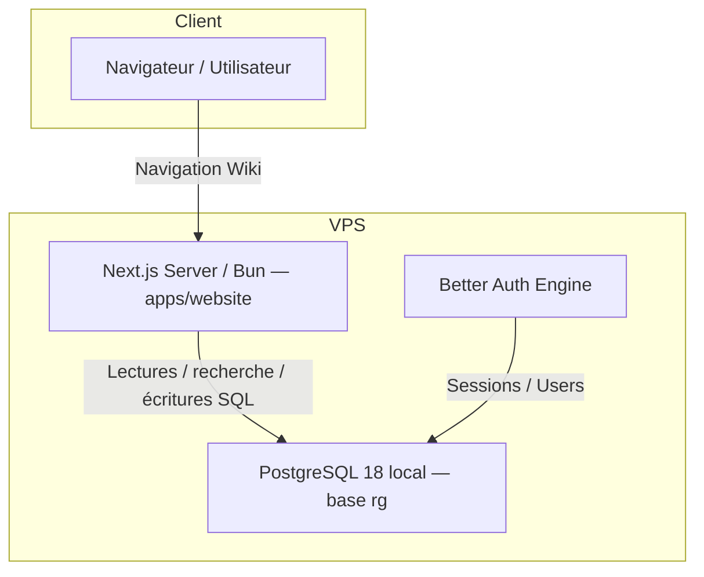

# Architecture de Base de Données & Cache Hybride (docs/database.md)

Ce document décrit l'architecture de la base de données du projet **Rose Griffon** (particulièrement pour le wiki **Azalée**, servi par `apps/website`), le flux de sauvegarde et de mise en cache, ainsi qu'une analyse de la gestion native du SQL par le runtime **Bun**.

Depuis le 11/8/2026, la pile est **entièrement self-hostée sur le VPS** (plus de
projet Supabase Cloud, plus d'URL `*.supabase.co`) : voir
[self-host-supabase.md](self-host-supabase.md) pour le détail des services de
remplacement (PostgREST, Storage, Realtime) et [deploy.md](deploy.md) pour la
publication.

---

## 1. Architecture actuelle d'Azalée

La source durable est PostgreSQL. Les chemins runtime, recherche, parsing
persisté et développement partagé utilisent les façades SQL de `@rosegriffon/db`.
SQLite est limité aux imports/extractions et au développement hors ligne ; il ne
remplace pas PostgreSQL en production et aucun fallback silencieux ne doit être
ajouté.



### A. Flux de données

1. **Données du Wiki (personnages, techniques, objets, drops, texte, CPK)** :
   - importées depuis les sources du jeu via les outils d’extraction ;
   - persistées dans les projections PostgreSQL `inagle_*` ;
   - lues par le runtime via SQL/Kysely.
2. **Données dynamiques (utilisateurs, sessions, favoris, logs)** :
   - persistées dans PostgreSQL ;
   - les endpoints HTTP/Storage/Realtime restent des adaptateurs de transport,
     pas des sources de données concurrentes.

---

## 2. Analyse Interne : La Gestion Native du SQL par Bun

L'analyse du code source de Bun (dans `src/`) révèle des choix de conception axés sur des performances extrêmes.

### A. SQLite (`bun:sqlite`)

SQLite est la base de données la plus optimisée de Bun en raison de son intégration directe dans le binaire :

- **Compilation Statique** : Le code source de SQLite (`sqlite3.c`) est directement inclus dans l'arbre de compilation de Bun. Aucun chargement dynamique (`dlopen` ou FFI externe) n'est requis.
- **Bindings Basse Latence C++** : Bun définit des liaisons C++ directes avec JavaScriptCore (JSC) via `JSSQLStatement.cpp` et `JSSQLStatement.h`. Les méthodes `run()`, `get()`, `all()`, et `values()` s'exécutent en code machine synchrone sans surcoût.
- **Interface JavaScript** (`src/js/bun/sqlite.ts`) : La classe `Database` de Bun charge le constructeur C++ natif à l'aide d'une macro interne `$cpp` :
  ```typescript
  ({ 0: SQL, 1: internalFieldTuple } = $cpp(
  	"JSSQLStatement.cpp",
  	"createJSSQLStatementConstructor"
  ));
  ```

### B. Le SQL Universel (`bun:sql`)

L'API `import { sql } from "bun"` unifie l'accès à PostgreSQL, MySQL et SQLite via les templates littéraux :

- **Architecture JavaScript** (`src/js/bun/sql.ts`) : Ce module gère les pools de connexions et instancie des adaptateurs dédiés (`PostgresAdapter`, `MySQLAdapter`, `SQLiteAdapter`).
- **Adaptateur SQLite** (`src/js/internal/sql/sqlite.ts`) : Il enveloppe le module synchrone `bun:sqlite` mais retourne des promesses pour s'aligner sur l'interface asynchrone globale.
- **Moteur Hybride Zig & Rust (PostgreSQL / MySQL)** :
  - Pour se connecter aux bases réseau, Bun n'utilise pas de librairie JavaScript pure (comme `pg`).
  - Il embarque une **Crate Rust** (`src/sql_jsc`) compilée de manière statique au sein du binaire Bun.
  - Le bas-niveau (sockets TCP, cycle de vie réseau, TLS) est écrit en **Zig**, tandis que le protocole de communication, le parsing binaire des paquets, les itérateurs d'objets (`ObjectIterator.rs`) et l'authentification SASL (`SASL.rs`) sont écrits en **Rust**.
  - Les sockets et données réseau reçus sont injectés directement dans le tas JavaScriptCore sous forme d'objets hôtes natifs (`$ZigGeneratedClasses.PostgresSQLConnection`), garantissant un traitement "zero-copy".

---

## 3. Procédure de Synchronisation & Sauvegarde

### A. Miroir SQLite du wiki

Le miroir `apps/website/data/mirror.sqlite` est produit côté dépôt `niers`
(matérialisation des tables `inagle_*`) puis republié avec la release, via
`scripts/ops/release-stack.ts` (étape `nie-mirror`, désactivable avec
`--skip-mirror`). Il n'y a plus de script de bascule Supabase Cloud → SQLite :
la base source est déjà locale.

### B. Sauvegarde Postgres complète

La base `rg` (PostgreSQL 18 local, y compris le schéma `achillea` depuis sa
fusion) est sauvegardée par [`scripts/ops/sauvegarde.ts`](../scripts/ops/sauvegarde.ts) :

```bash
bun scripts/ops/sauvegarde.ts
```

Les dumps vérifiés sont conservés sous `/var/backups/postgres`. Il n'existe
plus de base distante à extraire : toute restauration se fait vers/depuis
l'instance PostgreSQL locale.
