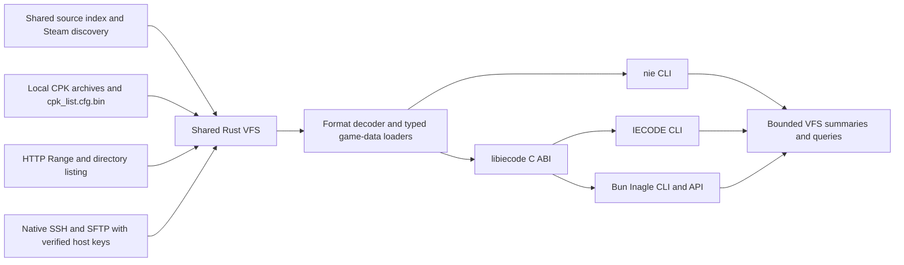

# Direct game data through the CLI and library layers

The installed game is the data source. NIE, managed IECODE and Inagle mount the
same CPK-backed VFS and read requested resources in memory. Analysis does not
require extracting a mirror, generating JSON game data, or initializing a
PostgreSQL database. Explicit SQL publishing/import commands remain separate
administrative operations.

## Resource flow



Rust owns the archive mount, native format decoders and game-data DTOs. The C
ABI owns handle lifetime, typed CFG decoding, bounded queries and output buffers.
Managed IECODE and Inagle adapt those existing results to their public APIs.
They do not parse CPKs a second time or depend on a full game-data mirror.

## Root commands and data boundaries

| Command family                                     | Reads the install directly                                      | Output behavior                                                    |
| -------------------------------------------------- | --------------------------------------------------------------- | ------------------------------------------------------------------ |
| `nie info`, `nie vfs stats`, `nie vfs find`        | VFS index and mounted resource metadata                         | Summary or bounded path results                                    |
| `nie vfs chara`, `nie vfs waza`                    | Typed records from the native game-data loaders                 | Filtered, bounded query; optional asset paths                      |
| `nie decode <path>`                                | One virtual path                                                | One decoded response in memory or explicitly requested output path |
| `iecode vfs stats/find/decode`                     | Shared VFS/C-ABI                                                | Entry count, bounded matches, one decoded virtual resource         |
| `iecode search-char`, `iecode analyze`             | Shared VFS/C-ABI                                                | Bounded query or streaming inventory analysis                      |
| `inagle stats/search/character/skills/items/teams` | Native typed domain queries plus existing in-memory VFS parsers | Counts and bounded results                                         |

All three tools accept an installation root, its `data/` directory, a `nie.exe`
path, or an `http://`, `https://`, `ssh://` or `sftp://` source. Their VFS operations
use the same native resolver and mount; a missing source or library returns a
nonzero status. Executable inspection and local rendering/export operations
still require their documented local inputs.

## Shared discovery and remote setup

Register an arbitrary location once; subsequent calls work from any directory:

```sh
nie vfs locate --game-dir /path/to/game/data/nie.exe --json
# Alternatively, index an unknown location once (this recursively scans that root).
nie vfs locate --scan-root /path/to/library --json
nie vfs locate --benchmark 1000 --json
iecode vfs locate --json
inagle locate --json
```

Resolution precedence is an explicit CLI/API hint, `NIE_GAME_SOURCE`,
`NIE_GAME_DIR`, `IECODE_GAME_PATH`, `NIE_GAME_PATH`, the persistent source index,
current/executable ancestors, then Steam libraries. Steam discovery reads
`libraryfolders.vdf` and app manifest `2799860`, including custom library paths.
An invalid explicit hint or environment override fails instead of silently
selecting a different installation. A stale local index falls back to discovery.

Successful mounts remember the actual data source. The index is one
credential-free text reference at `$XDG_CONFIG_HOME/nie/game-source`,
`$APPDATA/nie/game-source`, or `$HOME/.config/nie/game-source`. `NIE_CONFIG_DIR`
overrides that directory. Atomic replacement uses a private temporary file;
Unix source files have mode `0600`. No game rows or database are stored there.
An environment override takes precedence over the remembered source.

```sh
export NIE_GAME_SOURCE=https://assets.example.test/game/data
nie vfs stats
iecode vfs stats --json
inagle stats --json
# Existing Aphrody/OpenSSH host alias, with the original game directory on that host:
export NIE_GAME_SOURCE=ssh://game-host/absolute/path/to/game
iecode vfs find cfg.bin --limit 3 --json
```

Serve the original `cpk_list.cfg.bin`, `packs/` directory and any indexed loose
resources under the selected HTTP root. HTTP requires byte-range GET with exact
`206`/`Content-Range` responses, identity encoding and an HTML directory listing
of `packs/`. Referenced packs must all appear in that listing. Extra archives
are indexed from their TOCs. The client disables automatic decompression and
redirects; an HTTP server returning an entire archive to a range request fails
before its body is consumed. Optional bearer authentication comes only from
`NIE_HTTP_AUTH_TOKEN`; credentials, query strings and fragments in source URIs
are rejected before persistence. HTTPS uses the native TLS certificate checks.

SSH uses Aphrody's `aphrody-ssh::HostConfig` and `SftpDriver`, native `russh`
transport and `russh-sftp` reads. Configure the host alias, user, port and
`IdentityFile` through the existing Aphrody/OpenSSH configuration. Connections
verify the host or alias in `known_hosts`; unknown or changed keys are rejected.
`NIE_SSH_KNOWN_HOSTS` selects an alternate trust file and
`NIE_SSH_KEY_PASSPHRASE` supplies an encrypted-key passphrase. Password login,
SSH-agent authentication and jump hosts are not implemented in this mount.
The current Aphrody host resolver's supported config fields remain its contract.

Remote mounts read the complete logical index into memory, cache CPK metadata,
and fetch only selected byte ranges for decryption/decompression. They never
materialize a full archive or game-data mirror. Individual transport reads are
capped at 256 MiB, CPK metadata at 64 MiB, directory HTML at 4 MiB and operations
at 30 seconds. Closing the last remote handle joins its worker before an FFI
caller can unload the native library. Remote statistics count logical operations and resource payload
bytes; headers and listing bodies are excluded from the payload counter.

`discovery_ms` measures only native source resolution. CLI/runtime/library
startup, one-time recursive indexing, archive mounting and network latency are
separate costs. A universal first discovery below 10 ms on an unindexed disk is
not guaranteed. Cached discovery is measured, rather than treated as a hard
real-time promise.

Inagle uses the VFS by default. `InagleServiceConfig.dataSource` or the CLI's
dedicated `--data-source postgres` option explicitly selects an imported
projection. `INAGLE_DATA_SOURCE` is set by the CLI for that selected operation;
an unrelated inherited environment setting does not redirect default Inagle
service creation away from the VFS. PostgreSQL import and publish commands have
their own explicit entry points.

## Typed data and response shapes

Rust's existing `aphrody-nie-app::game_data` functions own the typed records.
`nie_vfs_query_json_out` takes a VFS handle and a small query request in memory;
it reports source, total records, matched records, offset and a page capped at
50,000. Records stay in a per-handle cache and that cache is released with the
handle. The loader covers every domain for which the Rust app already has a
native DTO loader. CFG input is read from the mounted VFS and decoded in memory.

JSON returned by CLI/API commands is a response. It is not a prerequisite game
dataset, generated import directory or required database. Query pagination
limits output size; whole-dataset serialization is not the default analysis
path. `scripts/tools/cli-evidence.ts` records response shapes by property type
and array length without preserving returned game records. Its private output
contains statuses and shapes, not stdout payloads.

## Whole-install observations

The 2026-10-03 `data/` installation contains 1,171 physical files, 61,587,961,011
physical bytes and 936 CPK archives. A prior complete NIE scan mounted 255,308
VFS entries, of which 232,414 parsed successfully. These are measured properties
of that installation and binary version; they are not required input files for
normal searches. Format coverage and the 256 MiB CRILAYLA output guard are
recorded in the [measured VFS reference](../formats/VFS-FORMAT-SPECIFICATIONS.md).

Earlier CLI probes exposed the specific defects fixed in the current sources:
NIE routed character/skill queries through a SQLite wiki mirror unless directed
otherwise; Inagle eagerly expected PostgreSQL projections and ignored the game
root; IECODE did not resolve the nested executable layout, and its analysis
command used a separate archive path. These now share the mounted VFS path.
The initial VFS cache uses 50,000-record pages and preserves full `total` and
`matched` counts. The direct 2026-10-03 qualification used freshly built Rust
and managed binaries and current Inagle sources: all 24 probes succeeded, NIE
and managed VFS totals matched at 255,308, and Inagle selected `vfs` with 6,101
characters, 1,004 skills, 1,820 items and 208 teams. It also exercised bounded
searches and typed CFG decoding. Physical input metadata was unchanged. The
collector does not compare every domain row across all public API shapes.

The remote-source qualification on 2026-10-03 passed 27/27 HTTP probes against
that same original installation, with matching 255,308-entry totals and all
four Inagle domain counts above. The local HTTP server received 148 requests,
including 115 range reads, 162,332,885 payload bytes and zero whole-archive
requests across the probes. All 1,171 input metadata records stayed unchanged.
The three auto-discovery probes ran without path hints or game environment
variables, from a private directory outside the repository. Their native
latencies were 0.038666 ms (NIE), 3.595564 ms (managed) and 0.059928 ms (Inagle).
An arbitrary-folder fixture indexed once produced p95 0.004097 ms and maximum
0.045245 ms over 1,000 cached resolutions. These are measurements on this host.

A separately configured real SSH server qualified mounting, inventory and exact
reads of two generated fixture resources through native Rust and the Bun C ABI;
managed inventory and analysis matched. An empty trust file rejected its host
key. This proves the SSH transport and adapters; it does not qualify a complete
licensed game installed on a remote SSH host or WAN performance.

Final stripped/minified PATH installations also pass 27/27 local and 27/27 HTTP
probes without library-path overrides. Installed-source cached discovery over
1,000 calls gives p50 0.003778 ms, p95 0.003859 ms and maximum 0.025599 ms.
Matching tools and the library reside together in `~/.local/bin`. Managed IECODE
is a framework-dependent single file requiring the installed .NET 10 runtime.
These local builds do not constitute a new published release.

## Reproduce from the repository root

```sh
bun run analyze:cli --help
bun run analyze:cli \
  --out /private/new-vfs-analysis \
  --game-dir /path/to/game-or-data \
  --library /absolute/path/to/libiecode.so \
  --nie /absolute/path/to/nie \
  --iecode /absolute/path/to/IECODE.Cli \
  --inagle /absolute/path/to/inagle
```

Add `--source https://host/game-or-data` to exercise remote transport while
`--game-dir` still selects the original local input for its integrity check.
The collector isolates the source index and environment, compares automatic
discovery across all three tools, then runs their VFS/domain probes.

The collector runs each executable with argument arrays and a 45-second
per-command limit, records exit codes, output shapes and duration, compares the
NIE/IECODE VFS entry counts, and fingerprints physical input size/time/mode
metadata before and after. Output goes under a new empty private directory
outside the repository and install. It redacts stdout/stderr and does not write
resource contents, domain rows, generated game files or database contents.

Qualification used `aphrody-nie-ffi` and `nie` from
`/tmp/iecode-nie-cli-target/debug`, current Inagle source through Bun, and the
managed apphost `/tmp/iecode-remote-managed-single/IECODE.Cli`. Pass the rebuilt shared
library through `--library` so the collector supplies both `IECODE_LIB_PATH`
and `NIE_FFI_PATH`. The private receipt is
`/tmp/iecode-http-source-evidence/receipt.json`; continuation notes and validation status
are in the current-session entry at the top of `PLAN.md`.

## Source ownership

Keep the root Cargo/Bun workspaces, managed solution, CMake graph and Python
workspace. Rust game data/VFS remains in `crates/nie`; Bun adapters and API in
`packages/inagle`; managed CLI/adapters in `src/IECODE`; one root evidence
adapter in `scripts/tools/cli-evidence.ts`. Reports do not justify moving or
copying source trees. See [monorepo conventions](MONOREPO-CONVENTIONS.md),
[workspace gates](../development/WORKSPACE.md) and the
[ordered acceptance plan](../../PLAN.md).
