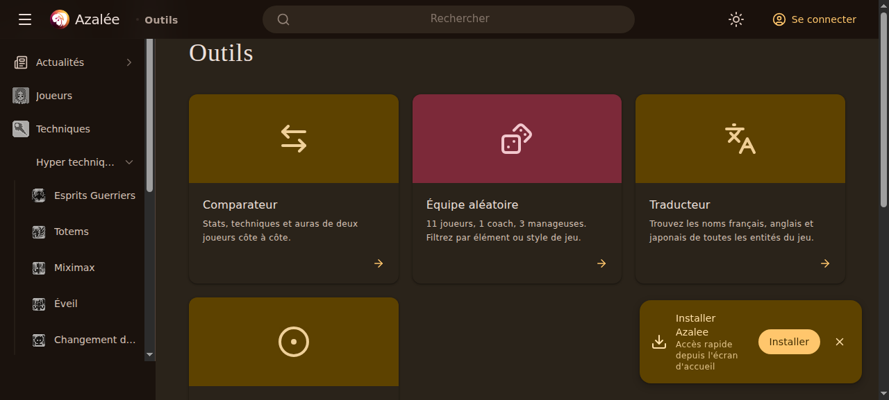
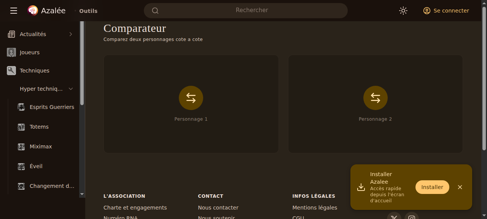
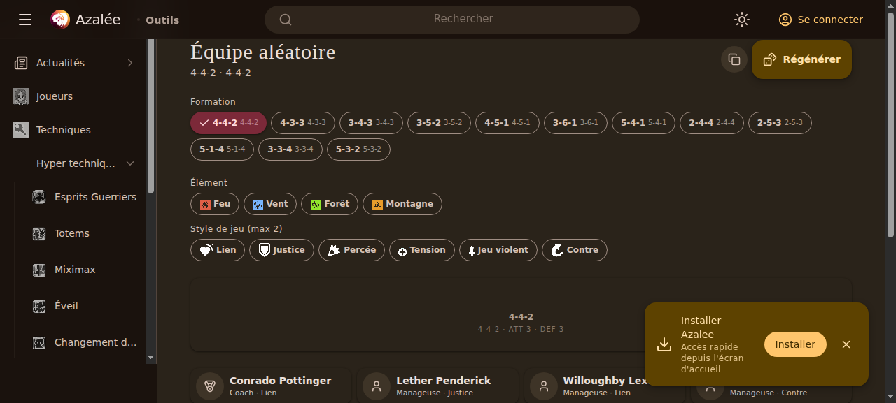
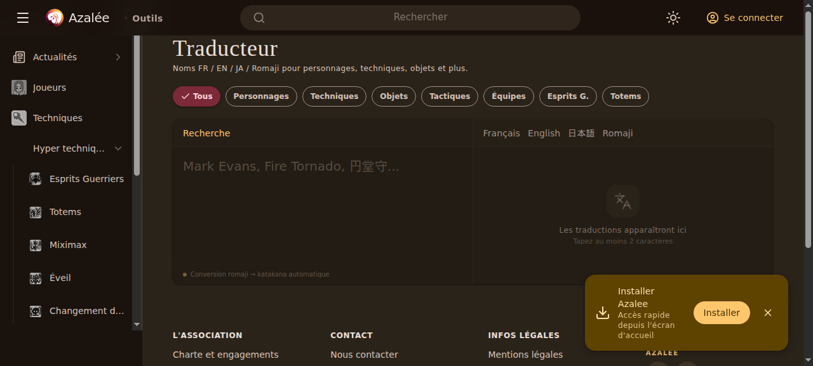
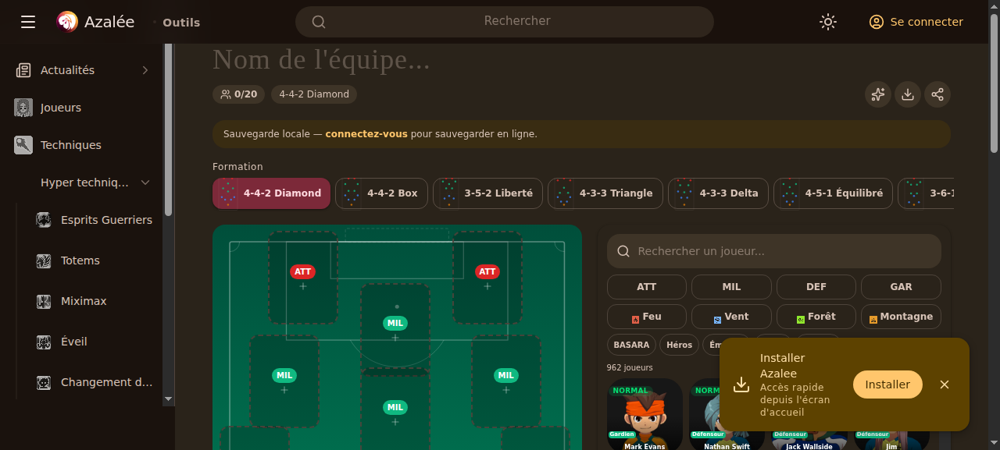

# Documentation des Outils d'Azalée

Ce dossier regroupe les analyses UI/UX, les captures d'écran, les spécifications techniques d'intégration des bases de données/APIs, ainsi que la documentation des commandes de test CLI du projet Azalée.

---

## 📸 Captures d'Écran et Interfaces Actuelles

Pour référence visuelle, voici l'état des interfaces capturées en direct sur le site de production :

### 1. Vue d'ensemble des Outils (`/tools`)


### 2. Comparateur de Personnages (`/tools/compare`)


### 3. Équipe Aléatoire (`/tools/random-team`)


### 4. Traducteur de Noms (`/tools/translator`)


### 5. Mon Équipe / Constructeur (`/tools/my-team`)


---

## 🔍 Audit UI/UX & Identification des Défauts

### 1. Vue d'ensemble (`/tools`)
* **Défauts identifiés** :
  - La grille de cartes de navigation est très simple et statique.
  - Manque de micro-interactions et d'effets visuels immersifs au survol (ex: halos colorés correspondant au thème du jeu).
  - Pas d'indicateurs dynamiques (ex: afficher le nombre de joueurs en base dans le comparateur, ou le nombre d'équipes enregistrées dans le Team Builder).

### 2. Comparateur de Personnages (`/tools/compare`)
* **Défauts identifiés** :
  - Lorsque aucun personnage n'est sélectionné, l'écran présente deux grands blocs vides gris et tristes, créant un sentiment de vide ("dead state").
  - Le slider de sélection de niveau (1 à 99) est très basique et manque de précision tactile.
  - La comparaison des techniques (moveset) liste les compétences côte à côte sans comparaison visuelle de puissance, coût TP, ou d'indications d'éléments.
  - La transition lors du chargement de personnages via la boîte de dialogue de recherche provoque un léger décalage visuel (layout shift).

### 3. Équipe Aléatoire (`/tools/random-team`)
* **Défauts identifiés** :
  - Les puces de filtres (chips) pour les éléments et les styles de jeu sont disposées en lignes qui se cassent de façon peu esthétique sur les écrans intermédiaires.
  - Le terrain de jeu affiché est une grille verticale simple qui ne donne pas un ressenti de "terrain de football" aussi réaliste que celui du Team Builder.
  - L'animation de tirage ("slot machine") manque de fluidité et de sons ou de retours haptiques/lumineux indiquant qu'un joueur a été tiré ou qu'un slot est verrouillé.

### 4. Traducteur de Noms (`/tools/translator`)
* **Défauts identifiés** :
  - La boîte de recherche est un simple textarea qui permet les retours à la ligne (ce qui casse le flux et n'est pas nécessaire pour une recherche de terme).
  - La distinction visuelle entre les langues (FR, EN, JA) se fait par de petites étiquettes, mais manque d'un affichage clair et premium avec drapeaux ou designs stylisés.
  - L'Assistant Tactique RAG en bas de page est déconnecté du flux principal et pourrait être mieux intégré sous forme de panneau latéral d'aide contextuelle.

### 5. Mon Équipe (Team Builder)
* **Défauts identifiés** :
  - Sur mobile, le bouton d'onglet segmenté pour commuter entre le terrain, la liste des joueurs et les statistiques utilise des couleurs très contrastées qui ne s'harmonisent pas parfaitement avec le vert du terrain.
  - Le système de drag-and-drop sur mobile peut parfois entrer en conflit avec le défilement vertical natif de la page si l'utilisateur ne maintient pas appuyé assez longtemps.
  - Les statistiques globales d'équipe manquent de représentations graphiques interactives (ex: diagramme circulaire de répartition des éléments).

---

## 🛠️ Plan de Refactorisation et Améliorations UI/UX

Le plan de refactorisation mené par les subagents cible les points suivants :

1. **Intégration Maximale des Données & APIs** :
   - **Service Inagle** (`packages/inagle`) : Exploitation complète des métadonnées de cartes (stats de base, variations de rareté, techniques débloquées par niveau, liens d'éveil).
   - **Assistant Tactique RAG** : Connexion sémantique directe pour proposer des astuces d'optimisation d'équipe, des suggestions de techniques de contre en fonction des éléments adverses, et des explications sur les effets des talents (passives).
   - **Zukan (Encyclopédie)** : Utilisation exclusive des rendus 3D officiels stockés sur le CDN Cloudfront avec système de secours (fallback) vers les icônes de visages 2D.

2. **Refonte Graphique (Material Design 3)** :
   - Remplacement des couleurs génériques par des palettes harmonieuses HSL sombres (`dark mode` par défaut).
   - Ajout d'animations fluides au survol et lors des transitions de pages (View Transitions).
   - Remplacement des grilles basiques par des layouts asymétriques plus modernes.

3. **Intégration au CLI (`bin/azalee.ts`)** :
   - Pour chaque outil web, ajout d'une commande CLI équivalente permettant de valider les algorithmes (interpolation, génération d'équipe aléatoire, traductions, construction d'équipe) directement dans le terminal.
   - Les commandes doivent supporter le format texte ASCII stylisé et l'option `--json` pour l'analyse automatisée.

---

## 📡 Spécification des APIs & Intégration CLI

### Commandes CLI de Test Disponibles

1. **Traducteur (`azalee translate`)** :
   ```bash
   # Traduction interactive ou par argument
   bun bin/azalee.ts translate "Mark Evans"
   bun bin/azalee.ts translate "Fire Tornado" --json
   ```

2. **Comparateur (`azalee compare`)** :
   ```bash
   # Compare les stats de deux joueurs à un niveau donné (par défaut 99)
   bun bin/azalee.ts compare "Mark Evans" "Axel Blaze" --level 50
   bun bin/azalee.ts compare "c01000100" "c01000020" --json
   ```

3. **Équipe Aléatoire (`azalee random-team`)** :
   ```bash
   # Génère une équipe avec filtres
   bun bin/azalee.ts random-team --formation "4-3-3" --element "Fire" --playstyle "Breach"
   bun bin/azalee.ts random-team --json
   ```

4. **Team Builder (`azalee team-builder`)** :
   ```bash
   # Gère et affiche les équipes enregistrées
   bun bin/azalee.ts team-builder list
   bun bin/azalee.ts team-builder show <team_id>
   bun bin/azalee.ts team-builder generate --formation "3-5-2"
   ```
