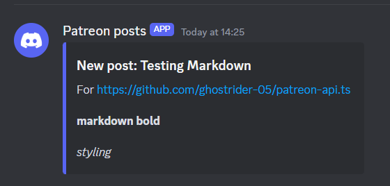
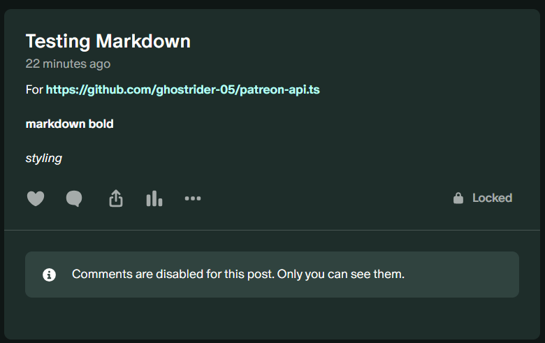

# Patreon posts to Discord

This is an example project for how to connect `@rosegriffon/patreon-bun` with Cloudflare Workers to send Discord messages on a new post.

Screenshots

Discord message:

Patreon post:

## Getting started

1. Clone / copy `/examples/cloudflare-webhook/` locally
2. Install dependencies: `bun install`
3. Get the webhook secret from Patreon by [registering a new webhook](#webhook-registration) using the Patreon API.
4. Update [the secrets](#secrets) on Cloudlfare to use your webhook
5. Deploy the worker with `bun run deploy` to your Cloudflare account
6. Create a post on Patreon and view the Discord message!

### Webhook registration

Register a webhook in your Patreon creator settings. Set its target URL to the
deployed worker endpoint, then save the webhook secret in your local secret
manager and configure the worker with Wrangler. Never commit the secret.

### Secrets

Update the following secrets using `wrangler`:

- `DISCORD_WEBHOOK_URL`: the url of the Discord webhook. You can click the `Copy url` button in the Discord client to get the url
- `PATREON_WEBHOOK_SECRET`: the webhook secret of your Patreon clients webhook.
- `HTML_MD_KEY`: the key to use for [the HTML to Markdown API](https://html-to-markdown.com/api). If you use a different converter you do not have to specify this secret
